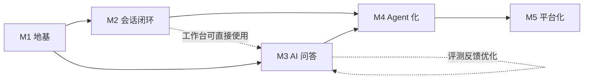

# 大型 AI Agent 智能客户应用 — 工程设计与开发规划

> 文档版本：v1.0 ｜ 日期：2026-10-11 ｜ 状态：待评审
>
> 配套文档：[架构设计](./架构设计.md) ｜ [技术选型与架构设计方案](./技术选型与架构设计方案.md)
>
> 技术栈：Go 网关 + Java 业务 + Python AI + Vue3 前端 ｜ Monorepo 管理

***

## 目录

1. [工程总览](#一工程总览)
2. [Monorepo 目录结构](#二monorepo-目录结构)
3. [各工程结构详解](#三各工程结构详解)
4. [代码规范与质量约束](#四代码规范与质量约束)
5. [开发里程碑详细规划](#五开发里程碑详细规划)
6. [里程碑依赖关系与关键路径](#六里程碑依赖关系与关键路径)
7. [交付闭环规范](#七交付闭环规范)
8. [附录：开发环境与工具链](#八附录开发环境与工具链)

***

## 一、工程总览

### 1.1 管理方式：Monorepo

采用单仓库多工程（Monorepo）管理，理由：

- 跨语言契约（Proto/OpenAPI）变更与联调在同一仓库内闭环，配套契约测试
- 一条 CI 流水线串起全部构建与测试，统一版本发布
- 支持原子提交：一个功能改动涉及多语言时一次提交完成

### 1.2 顶层工程划分

| 工程           | 语言/技术                    | 定位                       | 入口端口（规划）         |
| ------------ | ------------------------ | ------------------------ | ---------------- |
| `gateway-go` | Go 1.22+ / Gin           | 接入网关、WSS/SSE 长连接         | 8080 (HTTP/WSS)  |
| `core-java`  | JDK 21 / Spring Boot 3.3 | 业务中枢（DDD 多域）             | 8081 (gRPC/HTTP) |
| `ai-python`  | Python 3.12 / FastAPI    | AI 大脑（Agent/RAG/LLM 网关）  | 8082 (gRPC/HTTP) |
| `web-vue3`   | Vue3 + Vite + TS         | 用户端 / 工作台 / 管理台 / Studio | 3000 (dev)       |
| `deploy`     | Helm / Docker            | 多云与私有化交付                 | -                |
| `ops`        | Prometheus/Grafana/Loki  | 可观测性                     | -                |

### 1.3 跨语言契约管理

- **gRPC**：契约统一放 `gateway-go/proto` 与 `ai-python/proto`（单源生成，Java 侧用 `buf` 或 protobuf 插件生成）
- **REST/OpenAPI**：Java 域对外 API 以 OpenAPI 3 定义，前端据此生成 TS 类型（openapi-typescript）
- **事件契约**：Kafka 事件消息以 JSON Schema（Avro 可选）定义，契约测试（Pact）保证跨域兼容

***

## 二、Monorepo 目录结构

```
lingxi_agent/
├── docs/                        # 设计文档（本目录）
├── gateway-go/                  # Go 接入网关
├── core-java/                   # Java 业务域
├── ai-python/                   # Python AI 域
├── web-vue3/                    # Vue3 前端
├── deploy/                      # Helm Charts / 离线安装包 / 环境配置
├── ops/                         # 可观测性配置
├── scripts/                     # 工程脚本（初始化/生成/发布）
│   ├── init-repo.sh
│   ├── gen-proto.sh
│   └── build-all.sh
├── .github/
│   └── workflows/               # CI 流水线
│       ├── ci-gateway-go.yml
│       ├── ci-core-java.yml
│       ├── ci-ai-python.yml
│       ├── ci-web-vue3.yml
│       └── ci-e2e.yml
├── Makefile                     # 顶层命令入口（make build/test/dev）
├── docker-compose.dev.yml       # 本地开发依赖（MySQL/Redis/ES/Milvus/Kafka）
├── .editorconfig
├── .gitignore
└── README.md
```

***

## 三、各工程结构详解

### 3.1 `gateway-go`（Go 接入网关）

```
gateway-go/
├── cmd/
│   └── gateway/main.go          # 启动入口
├── internal/
│   ├── config/                  # 配置加载（env + yaml）
│   ├── middleware/              # 鉴权/限流/审计中间件
│   │   ├── auth.go              # JWT + 租户上下文
│   │   ├── ratelimit.go         # 令牌桶限流
│   │   ├── circuit.go           # 滑动窗口熔断
│   │   └── accesslog.go         # 访问审计
│   ├── handler/                 # HTTP 处理器（REST 转发）
│   ├── ws/                      # 长连接管理
│   │   ├── hub.go               # 连接注册表（百万级）
│   │   ├── session.go           # 会话映射与粘性路由
│   │   └── buffer.go            # 断连缓冲（30s, seq 续传）
│   ├── client/                  # 出站客户端
│   │   ├── java_grpc.go         # → Java 会话域
│   │   └── python_grpc.go       # → Python 同步通道
│   ├── kafka/                   # 事件生产/消费（ai.answer.chunk）
│   ├── auth/                    # JWT 签发/校验
│   └── metric/                  # Prometheus 指标
├── proto/                       # gRPC 契约（单源）
│   ├── session.proto
│   └── ai.proto
├── tests/                       # 单测 + 集成测试
├── go.mod
├── Makefile
└── Dockerfile
```

**职责边界**：网关不持有任何业务逻辑，仅做协议转换、流量治理与消息转发；所有业务校验收敛到 Java 域。

### 3.2 `core-java`（Java 业务域，DDD）

```
core-java/
├── pom.xml                       # 父 POM（依赖版本统一管理）
├── common/                       # 通用模块
│   └── src/main/java/.../common/ # 统一响应/异常/分页/工具/基类
├── gateway-api/                  # 对外契约（OpenAPI + 事件定义）
├── user/                         # 用户/租户/权限域
│   └── src/main/java/.../user/
│       ├── api/                  # 控制器/入参出参 DTO
│       ├── application/          # 应用服务（用例编排）
│       ├── domain/               # 实体/值对象/领域服务/仓储接口
│       └── infrastructure/       # MyBatis-Plus 实现/Redis/事件发布
├── session/                      # 会话域（状态机核心）
├── ticket/                       # 工单域（Seata 事务）
├── knowledge/                    # 知识库域（M3）
│   └── src/main/java/.../knowledge/
│       ├── api/                  # 知识库/文档/上传/切片状态接口
│       ├── application/          # 用例编排：上传校验、版本管理、切片任务下发、状态回写
│       ├── domain/               # 知识库/分类/文档/版本实体 + 切片任务状态机
│       └── infrastructure/       # MyBatis-Plus 仓储、OSS/MinIO 客户端、Kafka 事件发布
├── report/                       # 报表域（ClickHouse）
├── notify/                       # 通知域
└── start/                        # 启动聚合模块（装配各域）
    └── src/main/resources/
        ├── application.yml
        └── db/migration/         # Flyway 数据库脚本
```

**DDD 分层约束**：`domain` 不依赖 `infrastructure`（依赖倒置），事件发布统一走 `application` 层。

### 3.3 `ai-python`（Python AI 域）

```
ai-python/
├── pyproject.toml                # uv/poetry 依赖管理
├── app/
│   ├── main.py                   # FastAPI 入口（含 gRPC 服务）
│   ├── config.py                 # Pydantic Settings（全环境变量化）
│   ├── api/                      # REST 路由（健康检查/评测触发）
│   ├── gateway/                  # LLM 网关（双通道共用）
│   │   ├── router.py             # 模型路由策略
│   │   ├── providers/            # deepseek.py / qwen.py / glm.py / kimi.py / openai.py
│   │   ├── retry.py              # 指数退避重试
│   │   └── degrade.py            # 降级切换
│   ├── agent/                    # Agent 运行时
│   │   ├── graph.py              # LangGraph 图定义
│   │   ├── state.py              # 对话状态/上下文
│   │   ├── handoff.py            # 人工接管判定（置信度/规则）
│   │   └── tools/                # 工具定义与执行器（JSON Schema 校验）
│   │       ├── registry.py
│   │       ├── order.py          # 查订单（调 Java 域）
│   │       └── logistics.py
│   ├── rag/                      # 知识库与 RAG 管道（M3 核心）
│   │   ├── models.py             # 统一中间表示（Block/StructuredDoc/Chunk/ParentChunk）
│   │   ├── ingest/               # 入库管道（异步，Kafka 触发）
│   │   │   ├── pipeline.py       # 编排：解析→切分→向量化→索引→回写状态
│   │   │   ├── tokenizer.py      # token 估算 + 句界切分（句子不截断）
│   │   │   ├── parser/           # 按类型分流解析（每类一个模块）
│   │   │   │   ├── base.py       # 依赖缺失错误 + 表格语义化转写
│   │   │   │   ├── pdf.py        # pdfplumber（扫描件 OCR 为后续增量）
│   │   │   │   ├── docx.py       # python-docx（Heading 1-6 树）
│   │   │   │   ├── pptx.py       # python-pptx（按页/要点）
│   │   │   │   ├── sheet.py      # openpyxl / csv 表头语义化转写
│   │   │   │   ├── html.py       # 标准库提取（可换 trafilatura 去噪）
│   │   │   │   └── text.py       # Markdown / 纯文本
│   │   │   ├── splitter.py       # 结构感知递归切分 + 父子块生成（含元数据注入）
│   │   │   └── embedder.py       # bge-m3 批量向量化（稠密 + 稀疏）
│   │   ├── index/                # Milvus 集合与写入
│   │   │   ├── mapping.py        # Collection schema / HNSW + SPARSE 索引 / 别名切换
│   │   │   ├── rows.py           # 切分产物 → Milvus 行（纯函数）
│   │   │   └── writer.py         # 按 doc_id 全量替换 + 父块聚合回填
│   │   ├── retrieve.py           # Milvus 稠密 + 稀疏混合检索（RRF 融合）
│   │   ├── rerank.py             # bge-reranker-v2-m3 精排 + 父块回填
│   │   └── embedding_svc.py      # bge-m3 / reranker 独立服务入口（可独立部署）
│   ├── memory/                   # 长程记忆摘要
│   ├── privacy/                  # PII 脱敏（正则 + 启发式）与输出还原
│   ├── consumers/                # Kafka 异步通道消费
│   │   ├── session_message.py
│   │   └── batch_task.py
│   ├── evaluator/                # Golden Set 评测与回归
│   └── metrics.py                # Prometheus 指标
├── proto/                        # gRPC 契约（ai.proto 等）
├── tests/                        # pytest 单测 + 集成
├── Dockerfile
└── Makefile
```

**关键约束**：AI 域不直连业务库；LLM 调用统一走 `gateway`，禁止绕过。

### 3.4 `web-vue3`（前端）

```
web-vue3/
├── package.json
├── vite.config.ts
├── src/
│   ├── main.ts
│   ├── router/                   # 权限路由（用户端/工作台/管理台/Studio）
│   ├── stores/                   # Pinia：auth / session / workbench
│   ├── api/                      # 请求封装（axios + 类型生成）
│   │   ├── http.ts
│   │   ├── sse.ts                # ReadableStream 流式渲染
│   │   └── wss.ts                # 实时长连接封装
│   ├── views/
│   │   ├── portal/               # 用户端会话页
│   │   ├── workbench/            # 客服工作台（会话列表/消息/接管/工单）
│   │   ├── admin/                # 管理后台（租户/用户/知识库/权限）
│   │   └── studio/               # Agent 编排 Studio（拖拽画布）
│   ├── components/               # 通用组件（消息气泡/流式渲染/图表）
│   ├── composables/              # useChatStream / useSocket / useTicket
│   └── types/                    # OpenAPI 生成类型 + 领域类型
├── tests/                        # Vitest 单测 + Playwright E2E
└── Dockerfile
```

### 3.5 `deploy`（部署交付）

```
deploy/
├── helm/
│   ├── gateway-go/               # Go 网关 Chart
│   ├── core-java/                # Java 业务 Chart（多域子模板）
│   ├── ai-python/                # AI 域 Chart
│   ├── web-vue3/                 # 前端 Chart
│   └── infra/                    # 中间件 Chart（mysql/redis/es/milvus/kafka/clickhouse）
├── offline/                      # 私有化离线交付
│   ├── images/                   # 镜像 tar 包 + 导入脚本
│   ├── charts/                   # 打包好的 Helm 依赖
│   └── installer.sh              # 一键安装器
├── values/
│   ├── dev/                      # 环境差异配置
│   ├── staging/
│   └── prod/
└── k8s/                          # 公共资源（namespace/secret/ingress）
```

### 3.6 `ops`（可观测性）

```
ops/
├── prometheus/                   # 采集规则 + 告警规则（alertmanager）
├── grafana/                      # 面板 JSON（三语言全链路大盘）
├── loki/                         # 日志采集与检索
├── otel/                         # OpenTelemetry Collector 配置
└── loadtest/                     # 压测脚本（k6：对话/长连接场景）
```

***

## 四、代码规范与质量约束

### 4.1 各语言规范

| 语言             | 规范                  | 静态检查                  | 格式化                 |
| -------------- | ------------------- | --------------------- | ------------------- |
| Java           | 《阿里巴巴 Java 开发手册》    | Checkstyle + SpotBugs | google-java-format  |
| Go             | Effective Go + 官方风格 | golangci-lint         | gofmt / goimports   |
| Python         | PEP 8               | Ruff + Pylint         | Ruff format / Black |
| TypeScript/Vue | 阿里前端规范              | ESLint + Vue 官方插件     | Prettier            |

### 4.2 通用约束

- **命名**：领域术语统一（会话/工单/接管/知识/Agent 任务），禁用无意义缩写与单字母变量
- **提交规范**：Conventional Commits（`feat`/`fix`/`refactor`/`docs`/`test`/`chore`）
- **分支策略**：trunk-based（主干开发 + 短特性分支 + PR 评审），发布打 tag
- **测试要求**：
  - 单元测试：核心逻辑覆盖率 ≥ 70%（Java/Python/Go 关键路径）
  - 契约测试：跨语言接口全部 Pact 覆盖
  - Golden Set：AI 回答质量回归数据集持续维护
- **配置安全**：密钥/Token 一律环境变量 + Secret 管理，禁止硬编码进代码与镜像
- 代码注释使用中文。

***

## 五、开发里程碑详细规划

> 里程碑顺序依赖：M1 → M2 → M3 → M4 → M5。M2/M3 存在并行窗口（前端工作台与 AI 链路可分别推进）。

### 5.1 M1 地基 — 工程骨架与基础设施

**目标**：仓库、CI、本地开发环境就绪，四语言骨架可运行，跨语言链路打通（ping/health）。

**任务拆解**

| #    | 任务                                             | 域              | 产出与验收                                                       |
| ---- | ---------------------------------------------- | -------------- | ----------------------------------------------------------- |
| 1.1  | Monorepo 初始化、Makefile、git 规范、README            | 全体             | 仓库可 `make dev` 一键拉起                                         |
| 1.2  | docker-compose.dev：MySQL/Redis/ES/Milvus/Kafka | 运维             | 本地中间件一键启动，健康检查通过                                            |
| 1.3  | Go 网关骨架                                        | Go             | `/health`、JWT 中间件、限流中间件、访问日志；golangci-lint 通过               |
| 1.4  | Java 骨架                                        | Java           | 多模块（common/各域空壳）、统一响应/异常、Nacos 注册、Flyway 基线脚本；Checkstyle 通过 |
| 1.5  | Python 骨架                                      | Python         | FastAPI 启动、Pydantic Settings、健康检查；Ruff/Pylint 通过            |
| 1.6  | Vue3 骨架                                        | 前端             | Vite 工程、路由、Pinia、Naive UI 接入、请求封装（含 SSE 测试页）；ESLint 通过      |
| 1.7  | LLM 网关最小实现                                     | AI             | 接入 DeepSeek 非流式调用 + 超时/重试/降级框架，单测覆盖降级路径                     |
| 1.8  | gRPC 契约与骨架连通                                   | Go/Java/Python | 网关→Java 域 ping 通；契约测试（Pact）跑通                               |
| 1.9  | CI 流水线                                         | 运维             | 四个语言 CI Job 全绿（静态检查 + 单测 + 镜像构建）                            |
| 1.10 | Helm 基础 Chart + dev 环境                         | 运维             | 四服务 + 中间件可部署到 dev K8s                                       |

**里程碑验收**：`make build && make test` 全绿；dev 环境四服务健康检查通过；网关 → Java → Python 链路 ping 通。

### 5.2 M2 会话闭环 — 人工客服 MVP

**目标**：无 AI 情况下完成「用户咨询 → 人工客服 → 工单」全闭环，验证会话状态机与事件链路。

**任务拆解**

| #   | 任务        | 域    | 产出与验收                                              |
| --- | --------- | ---- | -------------------------------------------------- |
| 2.1 | 会话域状态机    | Java | 状态机（INIT/HUMAN\_CHAT/CLOSED）+ 事件发布；边界：重复关闭、非法迁移被拒绝 |
| 2.2 | 消息落库与查询   | Java | 消息按月分表，游标分页查询；边界：超大会话分页性能                          |
| 2.3 | WSS 长连接网关 | Go   | 会话粘性路由、心跳、断连缓冲 30s + seq 续传；边界：断连重连消息不丢不重          |
| 2.4 | 客服队列与接管   | Java | 排队/分配/抢单，事件经 Kafka 通知工作台；边界：并发抢单只成功一次              |
| 2.5 | 工单域       | Java | 工单创建/流转/关闭，Seata AT 事务；边界：并发更新冲突回滚                 |
| 2.6 | 客服工作台     | 前端   | 会话列表（实时）、消息区、快捷回复、一键建单                             |
| 2.7 | 用户端会话页    | 前端   | 发消息、收消息、重连恢复                                       |
| 2.8 | 集成测试      | 全体   | 两坐席 + 一用户端联调；E2E：接管→会话→工单全流程                       |

**里程碑验收**：端到端「用户咨询 → 坐席接管 → 会话 → 建单」走通；断连重连无消息丢失；并发抢单幂等。

### 5.3 M3 AI 问答 — LLM + RAG 流式链路

**目标**：AI 能基于知识库回答用户问题（多类型文档精细化切分入库 → 混合检索 → 精排生成），流式输出贯通，具备评测与降级能力。

**任务拆解**

| #    | 任务               | 域              | 产出与验收                                                                                                                                  |
| ---- | ---------------- | -------------- | -------------------------------------------------------------------------------------------------------------------------------------- |
| 3.1  | LLM 网关完整版        | AI             | 多模型降级链（DeepSeek 主 → qwen/glm/kimi 备，`LINGXI_LLM_PROVIDER_CHAIN` 配置顺序、未配密钥者自动跳过）、OpenAI 兼容协议统一基类（四家 Provider 复用 chat/SSE/Token 审计）、首字 10s/总 120s 超时、指数退避（`base*2^(n-1)`）、非流式/流式双通道降级切换；故障演练（多级备用依次失效仍由末位兜底）单测通过 |
| 3.2  | 知识库管理            | Java           | 知识分类/标签、文档上传与版本、租户隔离；边界：超大文档分片上传、重复上传去重、切片任务状态回写。**已交付**：`knowledge` 模块（DDD 四层）——知识库/分类/文档 CRUD（REST `/api/v1/kb/**`，管理后台直连）、原始文件落 MinIO（`tenant/kb/doc/version`）、内容 SHA-256 去重（唯一索引 `uk_kb_hash`）、版本管理（同 docId 覆盖新版本并回到待入库）、分片上传三段式（初始化 → 逐片（可乱序/重传）→ 合并校验齐全后按序拼接并计算哈希）、切片状态机 PENDING/INDEXED/FAILED/DELETED；`kb.doc.ingest`/`kb.doc.indexed` 事件闭环（AI 域消费入库并回写状态，版本号不匹配的迟到回写被忽略）；文档下线：逻辑删除 + 物理删除原件 + 释放内容哈希唯一槽位（同内容可重新上传）+ `kb.doc.delete` 事件（AI 域按 `doc_id + tenant_id` 清理向量切片） |
| 3.3  | 文档解析与结构感知切分      | AI             | 按类型分流解析（PDF/Word/PPT/Excel/CSV/HTML/MD）→ 结构感知递归切分 + 父子块生成；单测断言各类型切分边界（表格语义转写、跨页标题归属、超长段落句界切分）                                          |
| 3.4  | Embedding 服务与向量化 | AI             | 方案 C（云端稠密 + 本地稀疏）：云端 OpenAI 兼容 `/v1/embeddings` 出稠密向量（批量/超时/指数退避/维度校验；**默认指向国内低延迟服务**，可仅改 base_url 切换境内/境外），本地 jieba + BM25 风格 TF 出稀疏词权重，`HybridEmbedder` 组合写入 Milvus 双字段；`CachedEmbedder` 查询向量缓存（LRU+TTL）；备选本机 FlagEmbedding 自部署（原生完整但需算力） |
| 3.5  | Milvus 集合与入库管道   | AI             | 子块 Collection（稠密 FLOAT\_VECTOR + 稀疏 SPARSE\_FLOAT\_VECTOR）、tenant_id 分区键、HNSW/SPARSE 索引、按 doc\_id 全量替换、别名零停机切换、父块聚合回填；Kafka 异步触发与状态回写；入库端到端单测 |
| 3.6  | 混合检索 + Rerank    | AI             | Milvus Hybrid Search（稠密 kNN + 稀疏匹配，RRFRanker，过滤写入子请求 expr 保租户隔离）召回 Top-K（默认 10，可配）→ 云端 bge-reranker-v2-m3 精排 Top5（免本机部署；超时/退避/下标校验；失败或密钥缺失降级为 RRF 顺序）→ 父块回填；单测断言召回质量（Recall\@5）与跨租户隔离 |
| 3.7  | Agent 运行时最小图     | AI             | LangGraph `StateGraph`：加载上下文（历史裁剪）→ 检索（失败降级空上下文）→ 生成（非流式先通）；依赖注入 retriever/gateway 便于离线单测；`create_agent` 由 store 装配并编译图；暴露非流式接口 `/api/v1/agent/chat`（返回回答 + 引用来源）；检索经 `asyncio.to_thread` 放工作线程，不阻塞事件循环（实测 3 问题串行 1286ms → 并发 659ms）。工具调用/人工接管分支留待后续里程碑 |
| 3.8  | 流式全链路            | Go/Python/Java | 三主题契约：`lingxi.session.message`（Java→Python）、`lingxi.ai.chunk`（Python→Go）、`lingxi.ai.reply`（Python→Java 落库）；Python Provider SSE 流式 + 网关首字超时降级 → 逐片段 → Go 消费推 WSS `chunk` 信封 → 前端打字机；Java 幂等落库 AI 回答使 resume 可取到。**延迟优化实测**：优化前首字 3.3~8.0s（瓶颈为检索，占 82~88%；LLM 首字仅 0.6~0.9s）→ 经「换国内 embedding + 查询向量缓存 + 启用真实精排 + 嵌入/精排长连接复用 + 精排候选 Top20→Top10」四步，**首字降至稳态 1.2~1.6s（约 5~6x），缓存命中路径检索仅 ~0.3s**；剩余瓶颈为 LLM 首字 0.5~0.9s（模型固有波动） |
| 3.9  | PII 脱敏           | AI             | 手机/身份证/银行卡/邮箱（强正则）+ 地址（启发式，可开关）脱敏进模型 + 答案还原。**已交付**：`app/privacy/pii.py` 的 `PiiMasker` 会话级脱敏器——查询/历史/知识片段在**进模型前**脱敏（云端 embedding 亦不外泄，检索改用脱敏后问题；入库向量化前同样遮蔽、原文仍入库供引用），回答与**流式片段**按占位符边界缓冲还原；边界：占位符与原文冲突时顺延序号、多类 PII 重叠按「最长 + 优先级 + 非重叠」取舍（地址内号码随地址整体隐藏）、同一原文跨字段复用同一占位符；真实链路验证（DeepSeek 提示词无真实 PII、回答还原含真实值） |
| 3.10 | 评测中心 v1          | AI             | Golden Set 20+ 用例回归、Badcase 记录。**已交付**：`app/evaluator/` 模块——内置 Golden Set **26 条**（事实问答 / 同义改写 / 边界拒答 / 幻觉守卫）+ 内置种子知识文档（自动入库评测专用租户 `eval-tenant`/`eval-kb`，按 doc_id 全量替换可重复执行）；规则判定四维度（关键事实 AND/OR 归一化匹配、幻觉守卫 `must_not_contain` 且**句内否定/存疑语境豁免**、拒答正确性、引用命中仅作指标）；产出报告 JSON（通过率 / 拒答准确率 / 检索命中率 / 幻觉用例数 / 平均与 P95 延迟）+ **累积 Badcase JSONL 回流**；触发：CLI `python -m app.evaluator`（`--min-pass-rate` 作 CI 门禁）+ REST `POST /api/v1/eval/run` / `GET /api/v1/eval/report`；真实回归 **26/26 通过、拒答与检索命中率 1.0、无幻觉**（连续两次稳定） |
| 3.11 | 对话状态机 AI 化       | Java/Python    | AI\_ACTIVE 状态、上下文窗口管理（近 N 轮 + 摘要）。**已交付**：会话状态机新增 `AI_ACTIVE`（`INIT → {AI_ACTIVE, HUMAN_CHAT, CLOSED}`、`AI_ACTIVE → {HUMAN_CHAT, CLOSED}`），用户消息仅在 `INIT`/`AI_ACTIVE` 下触发 AI、**接管后 AI 退出**；客服队列含 INIT + AI_ACTIVE（均可接管），前端标签与「接管」按钮同步；会话事件携带 **近 N 轮历史 + 会话摘要**（Spring `lingxi.session.history-limit`），既有 Kafka 路径多轮上下文贯通；AI 侧 `app/agent/memory.py` 把**超出窗口的旧消息增量压缩**为摘要并经 `lingxi.session.summary` 回写 Java 会话（仅超窗才产生额外模型调用），提示词按「会话摘要 → 知识片段 → 对话历史 → 问题」分层拼装；真实链路验证（历史条数 0→2→4、超窗摘要回写 `摘要长度=109`、接管后 AI 不再应答） |

**里程碑验收**：各类型文档切片覆盖率 100%（无解析丢弃、表格语义不丢失）；召回 Recall\@5 达标；知识库 QA 准确率达标（Golden Set）；流式首字延迟达标；模型故障降级不中断会话；脱敏用例全过。

### 5.4 M4 Agent 化 — 工具调用与编排

**目标**：Agent 具备工具调用、记忆、人工接管联动，运营侧可编排工作流。

**任务拆解**

| #   | 任务            | 域              | 产出与验收                                                    |
| --- | ------------- | -------------- | -------------------------------------------------------- |
| 4.1 | 工具框架          | AI             | Function Calling + JSON Schema 强校验 + 白名单；非法参数被拒。**已交付**：`app/agent/tools/`（`spec`/`schema`/`registry`/`executor`/`audit`/`business`）+ `app/agent/tool_loop.py`；注册表即白名单（schema 强制 `additionalProperties=false` 杜绝夹带 tenant_id）；jsonschema Draft 2020-12 强校验，非法参数**调用前**被拒并回填可读原因；执行器统一超时 5s + 重试 1 次 + 降级话术；网关补 **OpenAI 兼容原生 Function Calling**（`tools`/`tool_calls` 流式分片累积 + 主备降级）；流式工具循环（直接作答时首字延迟不变，轮次上限 3） |
| 4.2 | 业务工具接入        | AI/Java        | 查订单/查物流/退换货（先 mock 后接 Java 域 gRPC）；超时 5s + 重试 1 次 + 降级话术。**已交付**：新增 `business.proto` 契约与 `core-java/business` 模块（DDD 四层 + JdbcTemplate + `BusinessToolGrpcImpl` 自动注册到 9090，租户隔离在 SQL 层强制，`schema.sql` 预置样本数据）；AI 侧 `BusinessToolClient` 惰性建连、同步 stub 经 `asyncio.to_thread` 不阻塞事件循环，tenant_id 由服务端上下文注入且不在 schema 中暴露；超时/重试/降级由执行器统一处理 |
| 4.3 | 工具审计          | AI             | 调用全量审计（入参/结果/耗时/费用）。**已交付**：`ToolAuditor` 对「成功 / 降级 / 被拒」三类**全量**记录（工具名、入参、结果长度与 sha256 摘要、耗时、重试次数、错误），入参与结果先经 PII 脱敏并截断；结构化日志 + `lingxi.tool.audit` Kafka 主题（会话键分区）；投递失败不影响工具调用主链路 |
| 4.4 | 记忆管理          | AI             | 长程摘要生成、跨会话记忆注入（按租户/会话隔离）。**已交付**：会话内摘要由 M3-3.11 承担，本次补齐**跨会话用户级画像**——`app/agent/memory_store.py`（Redis KV，key `lingxi:memory:profile:{tenant}:{user}` 按 tenant+user 隔离，缺 user_id 跳过；异步客户端 RESP2、读写超时降级、TTL 30 天）；`memory.py` 增 `merge_profile`/`sanitize_profile`（画像**不存 PII、不存占位符**：提示词禁止 + `pii.py::strip_placeholders`/`redact_pii` 兜底）；**写入复用超窗压缩触发点**（非超窗零额外模型调用）；**每轮注入** `【用户长期记忆】`（先于会话摘要，注入前脱敏）；Java `publishUserMessage` 增 `userId`、事件增 `user_id`；真实端到端核验跨会话生效与按用户隔离，Redis 不可达仅告警、问答不受影响 |
| 4.5 | 人工接管联动        | AI/Java/Python | 低置信度/用户要求/情绪规则触发接管，上下文摘要移交；边界：接管瞬间正在生成的回答终止。**已交付**：①AI 侧 `app/agent/handoff.py` 纯函数三类规则（用户明示 > 情绪 > 低置信度；低置信度=命中为空（默认开，仅在配置检索器时生效）+精排分阈值（默认关，量纲不可比）），命中即**跳过 LLM 生成**、回固定话术并投递 `lingxi.ai.handoff`；②Java 新增会话状态 **`WAITING_HUMAN`**（仍在客服队列、`aiAnswerable` 自动排除）、`HandoffConsumer` 消费转人工事件、`SessionEventPublisher.publishTakeover` → `lingxi.session.takeover`；③**终止生成**：AI 侧独立消费组写 `InterruptRegistry`，生成循环每片段检查 → 停止产出 + 终帧 `interrupted`/`reason` + **不回写 `ai.reply`（不落库半截回答）**；④**摘要移交**：`SessionSummary.summary`（Java 截断 200 字）经 Go 透传至工作台队列。真实端到端已核验（用户明示转人工 → `WAITING_HUMAN` 且队列可见 summary=200、后续无 AI 应答；生成中接管 → 「已产出片段=0」终止且未落库半截、会话转 `HUMAN_CHAT`；Kafka 关闭时正常启动） |
| 4.6 | 同步通道（坐席快捷回复）  | Java/Python    | gRPC 同步 + 独立线程池信号量（32）+ 超时 5s + 超载降级异步；压测验证线程池不泄漏。**已交付**：新增 `contracts/proto/agent_sync.proto`（`AgentSyncService`，**Python 实现服务端、Java 出站调用**）+ `session.proto` 加 `SuggestReplies`（Go→Java）；链路 **Go 工作台 → Java（组装上下文）→ Python（生成 1~3 条回复建议草稿，AI 不直接对客）**；Python 首个 gRPC 服务端用 **`grpc.aio` + `asyncio.Semaphore(32)`**（可直接 await 协程、无每请求线程；另设 `maximum_concurrent_rpcs` 硬顶），**闸门满默认不排队、立即降级**；**超时预算分层** Go 5s > Java 出站 4s > Python 生成 3.5s；**超载降级落在 Java** → 投 `lingxi.ai.suggest.request`，Python 异步生成后投 `lingxi.ai.suggest.result`，Go **只推坐席端**（新增 `role` 与 `BroadcastToRole`，防泄漏给用户端）；Kafka 关/投递失败时 `queued=false, reason=unavailable`（不谎报）；PII 进模型前脱敏、候选返回前还原。真实端到端已核验：正常路径 1.3s 返回 3 条候选；**40 并发精确 32 成功 / 8 转异步**（`BUSY`）、异步结果经 Kafka 送达；静置后闸门 `in_flight=0`（不泄漏）；Kafka 关闭时降级不谎报 |
| 4.7 | 编排 Studio     | 前端 + Java + Go | 拖拽节点（LLM/检索/工具/分支）、配置、发布版本；画布状态可回滚。**已交付**：Vue Flow 画布（节点面板拖入、连线拒绝自环/重复、分支节点双出边「是/否」）+ 按类型配置面板 + 快照式 undo/redo（`Ctrl/Cmd+Z`）+ 草稿/发布/版本抽屉/版本级回滚；新增 `workflow.proto` 契约与 Java 编排域 `workflow`（图定义 JSON + 发布全量校验：入口唯一/无环/分支配对/必填配置）+ Go `/api/v1/studio/*` 九条路由转发 + MySQL `lingxi_workflow`/`lingxi_workflow_version`；**回滚只改草稿、不新增版本**（复核后重发即生成新版本号，历史可审计）；为 4.8 提供「按版本加载图」的唯一数据源 |
| 4.8 | Agent 运行时多工作流 | AI | 按工作流版本加载图，路由版本灰度。**已交付**：新增 Python `app/agent/workflow/` 包——按工作流版本从 Java 编排域读取图定义并**编译成 LangGraph 图**（`retrieve`/`branch`（条件边）/`tool`（编译期工具白名单，复用流式 Function Calling）/`llm`（`get_stream_writer` 自定义流））；**版本灰度**由 Java 编排域承担（`canary_version`/`canary_percent` + 灰度发布「只推进 latest、不改 published」+ `SetRollout`），运行时按 **`crc32(session_id) % 100` 稳定分桶**选版（同一会话始终同一版本）；分层缓存（快照 TTL 30s、已编译图 TTL 300s/LRU）；分支表达式走**白名单 AST 求值（不用 eval）**，求值失败走 false 兜底；`stream_workflow_or_default` 与内置图**同签名同事件契约**，且**三重降级**回落内置图（开关关/未配默认工作流、编排域不可达、图非法或版本未发布）——编排绝不拖垮问答主链路 |

**里程碑验收**：工具链路（调用→校验→执行→回填→审计）完整；接管全流程自动化；同步通道降级演练通过；Studio 可发布并灰度一套工作流。

### 5.5 M5 平台化 — 报表、容灾与交付

**目标**：运营分析完备，多云双活与私有化交付可用，系统达到生产级性能与稳定性。

**任务拆解**

| #   | 任务     | 域       | 产出与验收                                      |
| --- | ------ | ------- | ------------------------------------------ |
| 5.1 | 数据分析管道 ✅**已交付** | Java/AI | 会话漏斗/满意度/Token 消耗 → 报表页面（**本期以 MySQL 落地：明细表 `lingxi_analytics_event` 以 `event_id` 幂等去重，聚合按「会话/统计日×租户×提供方×模型」落表；分析存储经依赖倒置端口 + `lingxi.report.store` 开关，可平滑替换为 ClickHouse**；埋点统一走 `lingxi.analytics.event` 单一主题，AI 侧经 `contextvars` 采集 LLM 用量（真实 usage 优先、缺失按字符估算并标注），Java 侧采集会话生命周期与满意度；Go 暴露 `/api/v1/reports/funnel|tokens|csat` 与 `/api/v1/session/:id/feedback`；Vue 新增 `/report` 报表页与门户评价入口） |
| 5.2 | 全链路压测 ⚠️**单机基线已交付（非分布式）** | 运维      | 以 `scripts/bench/load-test.py`（httpx + websockets）给出**可复现单机基线**，非 k6 集群压测。**REST 场景**（登录 + 报表/日志读）：并发 8、20s → 有效成功率 **100%**、QPS **97.6**、P50 **29.6ms** / P95 **43.9ms** / P99 **56.6ms**，**3607 次 HTTP 429**（网关**单 IP/单租户各 100 RPS（burst 50）**限流预期生效，非故障，已单列统计）。**chat 场景**（建会话 → WSS `?token=` → 单轮问答）：并发 6 → 成功率 **100%**，TTFT(发送→首片段) P50 **4452ms** / 整轮 P50 **5070ms**；**AI 侧单请求实测**检索 200–330ms、**首字 630–1060ms**、总耗时 ~0.9–1.3s。**关键瓶颈（已定位并修复）**：AI 会话消息消费原为**单消费者串行处理**（`consume_forever` 逐条 await），6 并发下第 N 个请求排队等待前序完成，故 TTFT 随并发上升——平台链路开销本身低（AI 侧首字 <1s），瓶颈在消费并发度。**修复（已实施）**：`consume_forever` 新增 `workers` 参数启用**分区级并行**——每分区一个工作协程（分区内严格有序）、跨分区并行，全局信号量封顶并发以保护下游 LLM；消息以 `session_id` 为键 → 同会话必落同一分区 → **「分区内串行」即「会话内有序」**；并行路径**关闭自动提交**并改为处理后**按分区手动提交**（自动提交按拉取位点推进会在处理完成前越过未处理消息）。会话消息主题分区 **3 → 6 → 12**（`kafka-local.sh init-topics` 幂等 alter，默认 12；消息以 `session_id` 为键，扩容只提升分散度、不破坏会话内有序）；并发度配置项 `LINGXI_KAFKA_SESSION_MESSAGE_WORKERS`（默认 4）。**优化后复测（并发 6）**：成功率 **100%**、**TTFT_P50 4452.6→1174.9ms（-74%）**、TTFT_P95 6872.7→**2181.8ms（-68%）**、整轮 P50 5070.6→**1544.8ms（-70%）**；日志确认 4 条会话**并行完成**且消费组 LAG=0（位点正常提交）。**分区提升至 12 后复测**：并发 6 连跑 3 轮 TTFT_P50 稳定在 **1082 / 1247 / 1313ms**（6 分区时为 1175 / 2790ms，方差大——多个会话哈希到同一分区会退化为串行）；并发 **12** 一次 → 成功率 **100%**、TTFT_P50 **2311ms**、P95 4753ms，12 条会话检索耗时回落到 200–500ms 且整批 ~4s 内完成。**当前瓶颈已转移**：12 分区下 **`workers=4` 才是实际并发上限**（12 个会话分散到 ~8 个分区，但全局信号量只放行 4 路），故后续提并发应调大 `LINGXI_KAFKA_SESSION_MESSAGE_WORKERS` 而非继续加分区。**踩到并修复两个真实缺陷**：①`OffsetAndMetadata` 的 metadata 传 `None` 被 aiokafka `commit_structure_validate` 拒绝（`TypeError: Metadata should be a string`），须传空串——已用真实 Kafka 最小复现确认；②并行工作协程为 fire-and-forget 任务，**异常被静默吞掉**导致该分区后续消息永不被处理（表现为「部分会话无应答且无任何错误日志」，本次曾一度造成 4/6 超时），已加提交异常兜底 + 协程退出告警 + 单测（假消费者复刻 aiokafka 的 metadata 校验）。**新增瓶颈观察**：4 路并发下检索耗时由 ~250ms 升至 ~1.6s（Embedding/Rerank 外部接口竞争），故 workers 默认取 4 而非更大值；**残留限制**：并发上限受「实际有消息的分区数」约束，若多个会话哈希到同一分区则仍串行（本次一次复测即因 5 会话落同一分区而只取得 2 路并行）。**未验证**：QPS 5000+ / 50 万长连接的分布式指标（需多机/K8s 与压测集群隔离）。**另修**：定位并修复「chat 场景全超时」根因——`ai-python/.env` 的 `LINGXI_KAFKA_ENABLED=false` 致**消费协程未启动**，用户消息进 `lingxi.session.message` 无人消费；置 true 重启后链路打通。 |
| 5.3 | 多云双活演练 | 运维      | 主 Region 故障切换演练，RTO < 5min、数据零丢失（**脚本/runbook 层可交付，集群切换验证需真实多 Region 环境，未验证**） |
| 5.4 | 私有化交付包 ✅**脚本与离线包已交付** | 运维      | `deploy/offline/`（README/manifest.yaml/`install-offline.sh`/`docker-compose.offline.yml`/`config/*.example`/`lib/common.sh`）+ `scripts/build-offline-bundle.sh`。**实跑自证**：打包产物 `deploy/offline/dist/lingxi-offline-1.0.0-20261016-053451.tar.gz`（215MB）、`SHA256SUMS` **293 项全 OK**、tar 包 `.sha256` 校验通过、构建幂等（连跑 4 次一致）、**缺失清单 0 项**；安装 **dry-run** 通过（命令/tar/curl/python/java/docker/node 前置、中间件 6 项可达、四端产物齐全），报告落 `deploy/offline/reports/install-<ts>.md`。**禁止 `docker pull`**（Milvus 走离线 `docker load`）。**未验证**：真实离线机端到端安装启动、Milvus compose 干净环境拉起、nginx 托管反代、wheels 跨平台可用性、K8s/Helm 部署、客户内网全流程。**差异记录**：仓库实际**无 `ops/` 目录**（原任务描述有偏差，脚本按可选资产容错跳过）。 |
| 5.5 | 租户隔离加固 | Java/Go | ✅**已交付**：**租户身份可信化**（Go 网关 HS256 解析 JWT → gRPC metadata 下传 `x-tenant-id`/`x-user-id`/`x-role` → Java `TenantGuardInterceptor` 注入 ThreadLocal 租户上下文，metadata 缺租户即 `UNAUTHENTICATED`；健康检查 `lingxi.health.v1.HealthService` 与业务工具 `lingxi.business.v1.BusinessToolService` 服务豁免）；**请求体/查询串 tenant_id 一律以可信租户为准**，与上下文不一致即 403（伪造租户被拒）；**会话域与工单域按租户归属强制校验**（越权对外按「不存在」返回，避免跨租户枚举探测），客服队列/坐席会话列表/工单列表按租户过滤；**数据隔离审计**：结构化 WARN 日志 `[tenant-isolation-denied]` 记录访问方租户/主体/资源/资源归属租户/动作，审计失败不影响主链路；**大租户独立资源组**：Java 按租户独占并发信号量（默认 64，`lingxi.tenant.quotas` 可单独提额，闸门对象数量封顶防内存膨胀）、Go 租户级令牌桶限流与独立配额（`GATEWAY_TENANT_RPS`/`GATEWAY_TENANT_RATE_BURST`/`GATEWAY_TENANT_QUOTAS`）；**真实端到端核验**：跨租户接管返回 404 且落审计、同租户接管成功、跨租户评价以「会话不存在」拒绝、队列只含本租户会话、全链路 AI 问答在租户 metadata 下正常流式产出、伪造租户 403                            |
| 5.6 | 运营后台完善 | 前端/Java/Go | 权限体系、操作审计、知识库运营视图（**2026-10-15 追加需求：登录页/菜单/用户模块/日志模块**，详细任务拆解见 §5.6） |
| 5.7 | 安全加固 ✅**已交付** | 全体 | **①Prompt 注入三层防护**：系统人设加固（`harden_system_prompt`，幂等）+ 不可信内容资料区隔离（`⟦资料:标签⟧` 包裹并**中和伪边界标记与 ChatML / 指令类特殊 token**）+ 输出侧泄露拦截（`detect_prompt_leak` ≥12 字连续片段比对 + `SAFE_FALLBACK` 兜底）与非流式替换、**流式守卫 `guard_stream_leak`**（累积检测、**命中即中断产出并补安全话术**）；注入审计 `log_injection_audit` **只记规则名与 session、不记原文**，**只告警不拒绝请求**；新增 19 项离线单测，**Python 全量 477 项全绿、ruff 通过**。**②评测中心**：Golden Set **26→32 条**（新增 4 条注入类，含 `injection-control-refund` **反向对照组**防加固误伤）+ 拒答标志词扩充「不能提供/不便提供/无法透露/不能透露」；真实回归 **32/32 通过**、拒答与检索命中率 1.0、幻觉 0、平均延迟 1321.5ms（P95 1724.0ms），**曾出现一次非确定性波动**（`guard-member-lifetime` 一次因模型未使用已检索片段失败，复跑全绿）。**③依赖漏洞扫描**：新增 `scripts/security/dependency-scan.sh`（单项失败不中断 + 汇总表 + 报告落盘）；真实结果 Node **SKIPPED**（私有 registry 无 audit 接口）、Java **SKIPPED**（dependency-check 需 NVD 联网 + Maven 本地仓库受限）、Python **2 处**、Go **11 处**；**已处置**：`golang.org/x/net` v0.57.0→**v0.60.0**（GO-2026-6617 等 HTTP/2 竞态复跑归零、Go 全量单测通过）、`pip`→**26.2.1**（复跑 Python **PASS 0 漏洞**）；**待处置**：Go 标准库 11 项均来自 **toolchain go1.27.1**（`net/http` 等，修复版 1.27.2，需升级本机/CI 工具链）、Node/Java 自动扫描能力缺口。**④接口渗透测试**：新增 `scripts/security/pentest.py`，真实 **25/25 通过**（伪造/篡改令牌与 Basic/乱码令牌均 401、**伪造 `X-Tenant-Id` 被忽略**、坐席越权 `/users` 等 403 而 `/reports/csat` 200 反向校验、跨租户 tenant_id 无效、3 条 SQL 注入载荷 401、路径穿越不泄露、超长输入 401、错误响应无堆栈/SQL、上传文件名净化、同 IP 并发 130 次触发限流）；另附 `scripts/security/README.md`。**⑤启动期安全告警**：`start/config/AuthConfig` 检测疑似示例 JWT 密钥（change-me/dev-secret/example）与初始口令 <12 位并打印 `[security]` 告警（不阻止本地启动）；**密钥卫生核查**：仓库仅跟踪 `ai-python/.env.example`，`.env`/`.env.*` 已忽略，`HEAD` 未发现真实密钥（sk-/api_key 模式） |
| 5.9 | API 接口日志链路追踪 ✅**已交付**（2026-10-19 追加） | Go/Java/AI/前端 | 一次请求在三端产生的调用链以**同一 traceId** 落库，管理端可查完整链路时间线。**契约**：HTTP header 与 gRPC metadata 统一 `x-trace-id`（网关为链路起点、入站已带即复用、回写响应头 `X-Trace-Id`）；Kafka 一律用**消息体 `trace_id` 字段**（不用 header）。**落库**：`schema.sql` 幂等新增 `lingxi_api_trace`（span_id PK + trace_id/tenant_id+started_at/entry 索引）；**各端直写 MySQL 但为进程内异步批量写**（有界队列 + 定时/满批 flush，满则丢弃计数、写库异常只告警，不阻断主链路）。**Java**：新模块 `core-java/trace`（四层：`ApiTraceSpan`/`ApiTraceRepository`/`ApiTraceBatchWriter`/`ApiTraceService`/`MySqlApiTraceRepository`/`ApiTraceController`）+ `common/trace/{TraceContext,TraceIds}` + HTTP `TraceIdFilter`（最高优先级，绑定/回写/清理防串号）+ HTTP span `HandlerInterceptor`（**注册在 AuthInterceptor 之后**，afterCompletion 逆序早于认证上下文清理以取到租户）+ gRPC `ApiTraceGrpcInterceptor`（**注册在 TenantGuard 之前即最外层**，直接读 metadata 身份，故**被租户守卫拒绝的调用也产生 span**）；查询 `GET /api/v1/traces`（筛选分页）与 `/{trace_id}`（按 startedAtMs 升序），`@RequireRole({admin})` + **租户强过滤**。**Go**：`internal/trace`（`ID`/`Span`/`Writer`：有界 channel + 后台批量写，DSN 空或开关关闭即 no-op）、`middleware/apilog.go`（仅 `/api/v1/**` 且排除探活）、REST 透传 header、gRPC metadata 增 `x-trace-id`、`ws` 按**每条消息**记 WSS span、Kafka 消费记 span、`cmd/gateway/main.go` 增两条 adminOnly 路由。**Python**：`app/trace`（contextvars + asyncio 队列 + `pymysql` 经线程池批量写、停机 flush）、FastAPI 中间件、Kafka 消费提取/生产注入 trace。**归属修正**：未认证请求（登录等）回落默认租户（与 `AuthService.login` 约定一致），AI 域在片段消息中回带 `tenant_id`，使流式片段 span 可按租户检索。**验证**：Java 236 项、Go 全包 ok、Python 506 项 + ruff、前端 `vue-tsc` + `vite build` 全绿；**真实端到端**——登录链路 2 span（网关+Java）、已认证 REST 链路 2 span、gRPC 链路（`lingxi.session.v1.SessionService/ListSessionsByUser`）、**异步 hop 100 span 跨三端**（`ai-python` 消费 `lingxi.session.message` → 97×`gateway-go` `lingxi.ai.chunk` → `core-java` `lingxi.ai.reply`/`lingxi.analytics.event`），管理端 API 按 traceId 完整返回。**未验证/限制（如实标注）**：全量采集且**不做清理**（表随流量膨胀）；队列满丢弃、进程崩溃丢未 flush span；旁路主题（`kb.doc.*`/`handoff`/`tool.audit`/`suggest`）v1 不记 span；多实例未验证 |

**里程碑验收（如实标注达成度）**：
- **压测**：已交付**单机可复现基线**（REST 有效成功率 100% / QPS 97.6 / P95 43.9ms；chat 成功率 100%），并定位「AI 会话消费单消费者串行」瓶颈；**QPS 5000+ / 50 万长连接的分布式指标未验证**（需多机/K8s + 压测集群隔离）。
- **容灾**：多云双活**未验证**（需真实多 Region 环境），仅脚本/runbook 层可交付。
- **私有化交付**：脚本层与离线包**已交付并通过打包 + 安装 dry-run 自证**（SHA256SUMS 293 项全 OK、缺失 0 项）；**干净内网端到端安装启动未验证**。
- **安全测试**：接口层未发现可利用漏洞（渗透 25/25），但**依赖层仍有 Go 标准库 toolchain（go1.27.1 → ≥1.27.2）待升级、Node/Java 自动扫描能力缺口待处置**（**尚未清零**）。

### 5.6 运营后台完善 —— 详细任务拆解（含 2026-10-15 追加需求）

**目标**：运营后台可用（登录 → 菜单导航 → 管理能力），身份与权限收口，关键动作可审计；
前端具备「智能平台」品牌化的科技感登录入口。

> 优先级：6.1 → 6.2 → 6.3（身份/菜单/日志，**本轮优先交付**）→ 6.4 → 6.5。

| #   | 任务 | 域 | 产出与验收 |
| --- | --- | --- | --- |
| 6.1 | 登录与用户模块 | Java/Go | ✅**已交付**：`user` 域（DDD 四层）+ BCrypt + JWT 签发 + 幂等预置管理员 + 统一 401 —— 账号表 `lingxi_user`（BCrypt 口令哈希、租户内用户名唯一、角色 admin/agent/user、启用/禁用）、登录签发 HS256 JWT（与网关同密钥、有效期可配）、预置管理员账号（用户名/初始口令由环境变量提供，**禁止硬编码**，首次启动幂等创建、未配置则跳过并告警）、登录失败统一 401 防用户枚举、`GET /api/v1/auth/me` 取当前身份；网关新增 `/api/v1/auth/*` 转发（登录路由豁免鉴权）；边界：禁用账号拒绝登录、口令错误不区分提示、密钥缺失拒绝启动 |
| 6.2 | 前端登录页与菜单 | 前端 | ✅**已交付**：科技感登录页 + 菜单按角色过滤 + 用户模块 + 路由守卫 + WSS `?token=` —— 科技感登录页（暗色 + 渐变网格 + 光效动效 + 内联 SVG 标识，文案「智能平台」，**零外部图片依赖**）、侧边菜单统一配置（门户会话/客服工作台/运营报表/编排 Studio/系统日志/用户管理，按角色过滤）、顶栏用户模块（用户名/角色/退出登录）、路由守卫（未登录跳登录页并 `redirect` 回跳、角色不足 403）、请求层自动附带 `Authorization`、WSS 以 `?token=` 传令牌（浏览器 WS 不支持自定义头）；验收：登录 → 菜单跳转 → 退出全流程可用，`vue-tsc` 通过 |
| 6.3 | 日志与审计模块 | Java/Go/前端 | ✅**已交付**：`lingxi_operation_log` 表与 `log` 域 + 登录/用户动作/隔离拒绝落库 + `GET /api/v1/logs` + 前端日志页 —— 新增操作日志表 `lingxi_operation_log`（主体/租户/模块/动作/资源/结果/来源 IP/耗时，只追加）与 `log` 域；落库来源：登录成败、用户管理动作、租户隔离拒绝（M5-5.5 审计端口换为落库实现 + 保留日志输出）；查询接口 `GET /api/v1/logs`（分页 + 模块/动作/结果/时间筛选，admin 限权）；前端新增「系统日志」页（筛选 + 分页表格）；**审计写入失败只告警不阻断主链路** |
| 6.4 | 权限体系收口 | Java/Go | ✅**已交付**：网关路由角色拦截 + Java `@RequireRole` + REST 认证拦截器 + 认证开关（**知识库 REST 已于 6.5 收口并纳入认证**）—— 角色模型落地（admin/agent/user）：网关按路由粗粒度拦截（studio/users/logs/报表 → admin；agent 路由 → admin/agent），Java 侧 `@RequireRole` 注解 + REST 拦截器细粒度校验（防绕过网关直连）；鉴权开关 `GATEWAY_ENABLE_AUTH` 生产必须开启；边界：越权返回 403、令牌过期返回 401 |
| 6.5 | 知识库运营视图 | 前端/Java/Go | ✅**已交付**：管理台知识库运营页（知识库选择/新建/编辑/启停、标签式分类增删、文档表格含**切片状态彩色 tag**与失败原因、状态筛选、≤4MB 单请求上传 / >4MB 自动分片（4MB/片，init→逐片→complete，带进度、失败即 abort）、逐行下线二次确认）对接既有 `/api/v1/kb/**`；**知识库 REST 租户改由身份上下文提供**（不再接受前端 `tenant_id`）；**仅 admin 双层限权**（Go 网关 `Group("/kb", adminOnly)` + Java `@RequireRole({admin})`）；**Go 网关新增 multipart 流式反向代理**（`httputil.ReverseProxy`，内存占用与文件大小无关，后端不可达回 503）；**修复 multipart 上传被认证拦截器触发的 400 缺陷**（`AuthInterceptor` 改用原始查询串解析 `?token=`，不再经会触发 multipart 解析的 `request.getParameter`） |
| 6.6 | 会话窗口与报表页调整（2026-10-16 追加） | 前端 | ✅**已交付**：**①智能会话新增「新建会话」**——`useChat.newSession()` 先断开当前连接并清空本地消息/评价态（防旧会话迟到片段混入新窗口）→ 申请新 `sessionId` 并覆盖 sessionStorage → 用新会话重连（旧会话在服务端保留）；按钮位于卡片右上角（带 loading 防重复）。**②会话页铺满内容区剩余高度**——AdminLayout 新增 `is-fill-height`（路由 `portal`，`min-height: calc(100vh - 56px)` + 纵向 flex），页面内卡片/内容区/主体/消息列表逐级 `flex:1` 传递剩余高度，消息列表由固定 `clamp(300px,52vh,480px)` 改为自适应并去掉原 `max-width:720px` 居中限宽（宽屏不再留白）。**③运营报表移除「返回用户端」按钮**（连带 `goPortal()` 与无用的 `useRouter` 一并清除）。**验收**：`vue-tsc --noEmit` + `vite build` 通过；**浏览器实测**——/portal 有「新建会话」按钮、发消息→点新建会话后消息清空且状态回到「在线」、新会话继续收发正常；消息区铺满内容区无留白；/report 标题栏已无该按钮且其余内容正常；控制台无报错 |
| 6.7 | 历史会话列表与会话持久化（2026-10-16 追加） | 前端/Java/Go | ✅**已交付**：前端「智能会话」新增**左侧历史会话列表 + 点击切换**（`portal/SessionList.vue`：预览省略号截断、状态标签与客服工作台同文案、相对时间、消息条数，原生 button 保证键盘可达；点击后 `switchSession` → `resumeFrom(0)` 回源拉该会话历史）；为支撑列表把**会话与消息真正持久化到 MySQL**——`schema.sql` 新增 `lingxi_session`（session_id 主键 + tenant_id/user_id/channel/state/agent_id/created_at_ms/last_active_at_ms/message_count/summary）与 `lingxi_session_message`（session_id/seq/sender/sender_id/content/message_id/created_at_ms，`(session_id,seq)` 唯一保证有序）+ `(tenant_id,user_id,last_active_at_ms)` 索引；`SessionRepository` 端口新增 `listByUser`（按 (tenant,user) 过滤、`last_active_at_ms` 倒序、`last_preview` 取末条消息截断）；新增 `MySqlSessionRepository`（`@ConditionalOnProperty(name="lingxi.session.store", havingValue="mysql", matchIfMissing=true)`，**完整实现端口**、状态机迁移/接管/队列与坐席列表/增量拉取/消息 seq 递增**逐方法对齐内存实现**，**跨租户一律表现为「不存在」**）与 `SessionOverview`（列表轻量视图），`InMemorySessionRepository` 收敛为 `havingValue="inmemory"`（仅单测/无 MySQL 环境）；`session.proto` 新增 `ListSessionsByUserRequest`（**仅 limit，租户/用户在 gRPC metadata、请求体不含，防越权枚举**）/`SessionListItem`/`ListSessionsByUserResponse` 与 `rpc ListSessionsByUser`；`SessionServiceGrpcImpl` 实现 `listSessionsByUser`（租户取自可信 metadata、**用户取 `TenantContext.current().userId()`**、limit 默认 20/上限 50）并**修复建会话归属用户**（改 `trustedUserIdOr`——一律以可信主体为准，仅上下文无用户主体时回落请求体并告警；原直接采信请求体 `user_id` 既会越权挂名、又会让「按本人主体查列表」查不到，实测踩到）；`AiReplyConsumer` 回复落库由「依赖内存引用」改**显式 save**（MySQL 化必需）；Go 网关新增 `ListSessionsByUser(ctx, limit)` 客户端方法（`SessionClient` 接口同步加）与 `GET /api/v1/sessions?limit=`（身份取 `tenant.FromGin` 可信上下文、缺租户 401、limit 收敛 [1,50]（缺省 20、非法回落 20）、**状态枚举转可读名**后下发，任意已认证角色）；配置新增 `lingxi.session.store: ${LINGXI_SESSION_STORE:mysql}`（默认 MySQL）、`session/pom.xml` 加 `spring-boot-starter-jdbc`。**布局两列化与踩坑修复**：`portal/Index.vue` 改两列（左列 248px 会话列表 + 右侧会话窗口），**≤1023 左列收起、由标题栏「会话列表」按钮唤起 n-drawer**，页面铺满内容区剩余宽高；①`.session-rail` 补 `min-width:0`（否则 flex 的 `min-width:auto`＝min-content，超长 nowrap 预览把左列撑到 745px、会话卡挤成 40px）；②naive-ui 2.40 卡片内容区类名是 **`n-card-content`（不带 `__`）**，写 `n-card__content` 不命中；③`n-space` 把子项包进**无 class 的包装 div** 使 `.chat-list` 的 `flex:1` 失效，故外层改自定义 flex 列；`AdminLayout.vue` 的 `content-inner` 新增 `is-fill-height`（路由 `portal`，**必须是确定高度 `height: calc(100vh - 56px)` 而非 min-height**——min-height 时子项 flex 拉伸不稳定，实测「有左列铺满、无左列不铺满」）。**验收**：`mvn -q test` **219 项全过**（0 失败/0 报错/1 跳过；既有 209 + 6.7 新增 5 + 并发修复新增）、`go build ./...` 与 `go test ./...` 通过、`vue-tsc --noEmit` 与 `vite build` 通过；**真实端到端**——重建 jar 并重启 core-java（13:16 构建）、重启 gateway 后：无令牌访问 `/api/v1/sessions` → **401**；建会话（前端仍传 `user_id=admin`）后立即查列表**能查到该会话且 `user_id` 已是可信主体 UUID**（修复前必为空）；发一轮问答后列表 `message_count=2`、`last_preview` 为 AI 回复、`state=AI_ACTIVE`、按最近活跃倒序；直查 MySQL 确认 `lingxi_session` 2 行、`lingxi_session_message` 2 行（seq 1=用户、2=客服）**确为真落库**；**无头浏览器核查** 1440×900 与 1000×820 两档左列 248px、预览省略号截断、消息区吃掉剩余高度（CDP 实测高度链 `.content-inner`677/`.portal-card`653/`.n-card-content`583/`.portal-body`563/`.chat-list`458）。**并发写丢数据修复（2026-10-16 追加，已实测）**：`SessionRepository` 端口新增 `int appendMessage(sessionId, draft)`——**返回由存储侧分配的权威 seq**；`MySqlSessionRepository` 该方法 `@Transactional`：`SELECT message_count FROM lingxi_session WHERE session_id = ? FOR UPDATE`（**仅锁该会话行 → 同会话串行、跨会话互不阻塞**）→ 用 `message_count+1` 直接插入消息（**已删原 `MAX(seq)` 跳过判断与 `ON DUPLICATE KEY UPDATE` 兜底——即覆盖丢数据之源**）→ `UPDATE lingxi_session SET message_count, last_active_at_ms` → 返回 seq；`save(session)` 收敛为仅 upsert 状态/列（不再写 message_count、不落消息）；所有消息写入调用点（`SessionServiceGrpcImpl.sendMessage` 的 **ack seq**、`AiReplyConsumer`）改用权威 seq；`InMemorySessionRepository` 同步实现。**修复前后实测对比**（同脚本同场景：经网关对**同一会话开 8 条并发 WSS 各发一条**）——修复前 ack seq `[1,1,1,1,1,2,1,1]`（大量重复）、库内仅落 **2/8**、`message_count=5` 与实际行数不符；修复后 ack seq `[3,8,2,1,6,5,7,4]`（**恰为 1..8、无重复**）、**8/8 全部落库**、库内 11 行 / 不同 seq 数 11 / seq 连续 1..11 / `message_count=11` 与实际一致。新增 `session/.../repo/SessionRepositoryAppendMessageTest`（端口契约单测）与 `start/.../repo/MySqlSessionRepositoryConcurrencyTest`（**真实 MySQL 并发用例：12 线程同会话 → 行数=`max(seq)`=`message_count`=12、seq 集合恰为 1..12；默认跳过、需 `-Dlingxi.it.mysql=true` 触发**）。**仍未验证（如实标注）**：**多实例（多 Java 进程）并发**未验证（本次为**单实例 + 真实 MySQL**）；MySQL 仓储的**其它非并发路径**仍以单测内存实现（InMemory）为主；`@Transactional` 事务管理器未在应用内单独验证
| 6.8 | 页面铺满与输入区对齐（2026-10-16 追加） | 前端 | ✅**已交付**：**①运营报表 / 知识库页铺满内容区剩余宽高**——`AdminLayout` 的 `is-fill-height`（内容区确定高度 = 视口 − 顶栏 56px、纵向 flex）由 `portal` 扩展到 `report`/`kb`；两页根容器由 `n-space` 改为普通 `div`（`n-space` 的无 class 包装层会使子项 `flex:1` 失效），**移除原 `max-width`（1080 / 1180px）居中限宽**，改 `width:100%` 纵向 flex 列（`gap` 承接原 `n-space` 间距），内容超出时页面内滚动。**②智能会话 / 客服工作台输入区与消息框左右对齐**——输入区由 `n-space` 改为自定义 flex 行 `.reply-bar`，输入框 `flex:1 1 auto; min-width:0` 吃掉剩余宽度、发送（含重连）按钮 `flex:0 0 auto` 贴右，整行与消息框 `.chat-list` 左右边缘对齐。**验收**：`vue-tsc --noEmit` + `vite build` 通过；**CDP 实测（1440×900）**：`/report`、`/kb` 的 `.report-page`/`.kb-page` 计算样式 `max-width=none`、`display=flex`、`flex-direction=column`、`overflow-y=auto`，宽 **1178px**（= 内容区 1226px − 左右内边距 24px×2，**两侧无留白**）、内容区高 **844px**（= 900 − 56，**吃满剩余高度**）；`/portal`、`/workbench` 的 `.reply-bar` 与 `.chat-list` **leftDiff = rightDiff = 0**（左右完全对齐），`n-input` `flex-grow=1`（宽 804px / 480px）。**③智能会话左列卡片宽度不随内容变化**——`SessionList.vue` 的 `.session-list` 补 `width:100%`（原为 `auto`，无历史会话时空状态内容撑不开、卡片塌陷得比有会话时窄；实测同一「内容极少」场景 **`auto`=98px → `width:100%`=248px**，与有会话时同宽） |

**验收（6.1–6.8 已达成）**：管理员可用密码登录并进入后台，菜单按角色过滤；**6.6 追加**：智能会话可「新建会话」并在新窗口继续收发、会话窗口铺满内容区剩余高度、运营报表已移除「返回用户端」；**6.7 追加**：智能会话新增左侧历史会话列表并支持点击切换（会话与消息已落 MySQL，`GET /api/v1/sessions` 按本人主体返回、按最近活跃倒序、状态枚举转可读名），建会话归属用户改以可信主体为准（修复越权挂名与「按本人查列表为空」）；**并发写丢数据已修复**——消息 seq 改由存储侧分配（MySQL 以 `SELECT message_count ... FOR UPDATE` 仅锁会话行，同会话串行、跨会话互不阻塞），**真实 MySQL 实测同会话 8 并发 8/8 全落库、ack seq 恰为 1..8**；用户模块可查看身份与退出；
日志页可按模块/动作/结果/时间筛选；**单元测试**——Go 全量通过（新增 proxy 4 项、require_role 5 项、会话列表 `TestListSessions` 4 子用例），Java 全量 **209→219 项**通过、0 失败/0 报错/1 跳过（6.1–6.6 新增 log 域 9 项、user 域 15 项；6.7 新增会话列表 5 项；**并发修复新增端口契约单测与真实 MySQL 并发用例，其中并发用例需 `-Dlingxi.it.mysql=true` 触发故默认跳过**），前端 `vue-tsc --noEmit` 与 `vite build` 通过；
**真实端到端核验**：未登录访问受保护接口 401、口令错误登录 401 且提示一致、管理员登录成功（令牌含 `tid`/`role`）、`/auth/me` 200、用户列表与系统日志可查（日志含登录成败与来源 IP/UA）、重复创建用户名 409、坐席访问用户管理 403 而访问报表 200、坐席访问 Studio 403、篡改令牌 401、WSS 带 token 连接成功并完成 71 片段流式回答、WSS 无 token 被拒 401。**6.5 真实核验**：未带令牌访问 `/api/v1/kb/bases` → 401、坐席角色 → 403（网关拦截）、管理员 → 200；新建知识库（不传 `tenant_id`，服务端按身份归属 `lingxi`）、新建分类 → 200；**单请求 multipart 上传** → 200；**分片上传**（init→乱序逐片→complete）→ 200（PENDING）；入库回写 **INDEXED（child_count=1/parent_count=1）**；相同内容重复上传 → **40902 去重**；下线 → DELETED；不存在知识库 ID → 业务错误「知识库不存在」；前端 `vue-tsc --noEmit` 通过。**6.7 真实核验**：重建 jar 并重启 core-java（13:16 构建）、重启 gateway 后——无令牌访问 `/api/v1/sessions` → **401**；建会话（前端仍传 `user_id=admin`）后立即查列表**能查到该会话且 `user_id` 已是可信主体 UUID**（修复前必为空）；发一轮问答后列表 `message_count=2`、`last_preview` 为 AI 回复、`state=AI_ACTIVE`、按最近活跃倒序；直查 MySQL 确认 `lingxi_session` 2 行、`lingxi_session_message` 2 行（seq 1=用户、2=客服）**确为真落库**；**无头浏览器核查** 1440×900 与 1000×820 两档左列 248px、预览省略号截断、消息区吃掉剩余高度。**6.7 并发写修复与核验（2026-10-16）**：**并发写丢数据已修复**——消息 seq 改由存储侧分配（`SessionRepository.appendMessage` 返回权威 seq）、MySQL `SELECT message_count ... FOR UPDATE` **仅锁会话行**（同会话串行、跨会话互不阻塞），实测同会话 8 并发 **8/8 全落库、ack seq 恰为 1..8**；Java 全量 **219 项**（0 失败/0 报错/1 跳过）。**仍未验证（如实标注）**：**多实例（多 Java 进程）并发**未验证（本次为**单实例 + 真实 MySQL**，非分布式多实例并发）；MySQL 仓储的**其它非并发路径**仍以单测内存实现（InMemory）为主；`@Transactional` 事务管理器未在应用内单独验证。**6.8 追加核验**：运营报表与知识库页已铺满内容区剩余宽高（`max-width=none`、宽 1178px、内容区高 844px），智能会话与客服工作台输入区与消息框**左右完全对齐**（CDP 实测 leftDiff = rightDiff = 0）；智能会话左列卡片改 `width:100%`，**无历史会话时不再塌陷**（实测同一「内容极少」场景 98px → 248px）。

### 5.8 交付体验增强 —— 追加需求（2026-10-16）

**目标**：开箱可用与观感提升——本机一键起全套环境、后台界面自适应各类屏幕、登录入口具备科技感品牌化动效。

| # | 任务 | 域 | 产出与验收 |
|---|---|---|---|
| 5.8.1 | 布局自适应 | 前端 | 四档断点（<768/768–1023/1024–1279/≥1280）：侧栏 <1024 收图标栏、<768 改抽屉+汉堡；KPI 栅格化、筛选区换行、表格横向滚动、工作台 <1024 转为堆叠、编排画布自适应；全局 min-width:0/box-sizing/overflow-wrap；边界：544px 窄视口无横向溢出（已实测），1440/1024/768 断点待真机复核 |
| 5.8.2 | 一键启动脚本 | 运维/全体 | `scripts/start-all.sh`：中间件（MySQL/Redis/Kafka/Milvus/Nacos）+ 四端服务，幂等可重复、`--middleware/--services/--no-frontend` 分段、`status`/`stop`/`stop --all`、日志与 PID 落 `logs/`（gitignore）、共享配置环境变量化、IPv4/IPv6 双栈探测；`make up/status/down/down-all`；边界：MySQL 需 sudo 与 Docker 未启动分支会给出可执行提示而非假装成功 |
| 5.8.3 | 登录页科技感动画 | 前端 | 3D 线框立方体 + 双层数据环 + SVG 神经网络流光 + 扫描光带 + 粒子；仅用 transform/opacity、装饰层 pointer-events:none、尊重 prefers-reduced-motion、无随机数与大量 DOM；验收：浏览器实测 5 类实体可见且在动、登录可用 |
| 5.8.4 | 登录页「外太空 + 飞船」场景（2026-10-16 二次追加） | 前端 | 新增独立装饰层组件 `views/login/SpaceScene.vue`（846 行，装饰实体全部迁入），登录逻辑（表单/校验/错误/loading）**零改动**。实体：**①深空星野**（3 层视差星空用多层 `radial-gradient` 平铺，非 DOM 膨胀；16 个闪烁星点仅 opacity/scale）+ 2 团星云；**②行星系统**（径向渐变受光面 + 伪元素纹理自转 + 晨昏线；光环 `perspective`+`rotateX(74deg)` 倾斜、`conic-gradient`+mask 挖空成环并流光；卫星轨道容器 `scaleY` 压扁成椭圆、旋转公转 + 内层反向自转保持朝向）；**③飞船**（2 艘内联 SVG 流线舰体，`keyframes` 组合 `translate3d(vw,vh)+rotate` 模拟曲线轨迹——因 `offset-path: path()` 需 px 坐标、响应式差而改用可随视口缩放的变换方案；引擎尾焰 `::after` 渐变条 `scaleX` 脉动）；**④跃迁光条**（6 条，周期内仅前 10% 掠过）；**⑤星座**（既有 SVG 神经网络改造为亮星节点 + 细连线）；**⑥保留既有**线框立方体/双数据环/扫描光带/漂浮粒子。约束：**零外链图片/零新增依赖**、动画仅 transform/opacity、`will-change` 仅 2 处、未用大面积 `filter:blur`/canvas、装饰层 `pointer-events:none` + `z-index:0` 而卡片 `z-index:2`、`prefers-reduced-motion` 下暂停全部动画并保留静态构图、≤1023 隐藏行星与立方体避免与卡片冲突。**验收**：`vue-tsc --noEmit` 与 `vite build` 通过；**浏览器实测**（`localhost:3000/login`）星野/飞船/行星光环/跃迁光条/星座连线/卡片**全部可见**、连续截图对比**确认在动**（飞船位移、光条掠过、星点闪烁）、**控制台无 JS 报错/Vue 警告**、admin 登录后跳转 `/report`、**544px 窄视口无横向溢出且无遮挡**。**2026-10-16 二次打磨（电影感 + 想象力元素 + 交互联动，按用户选定方向实施）**：**①想象力元素**——流星 3 条（周期 12/17/22s、缓入缓出、拖尾渐隐）、深空空间站（内联 SVG：核心舱 + 桁架 + 双太阳能板 `scaleX` 收放模拟对日翻转、整体 44s 漂浮）、陨石带 8 颗（上飘 + 自转）；**②电影感**——飞船轨迹改为**每关键帧内声明 `animation-timing-function`**（起步加速 → 持续加速 → 巡航 → 减速滑出），机身 roll、尾焰拆为「外焰随巡航速度变化 + 内核高频闪烁」；并统一全场景时长节律；**③交互与联动**——`pointermove` + rAF + 阻尼插值实现的**指针视差**（写 CSS 变量供各层乘 `--depth`，避免与各层自身 transform 动画冲突；收敛后自动停帧）；登录页新增 `sceneState` 驱动 `.is-submitting`（跃迁充能）/`.is-success`（跃迁爆发 + 一次性爆闪，跳转前留 240ms 让效果可见）/`.is-error`（抖动 + 红色晕染，900ms 复位）。**边界与实测**：仍为**零外链图片 / 零新增依赖**、仅 `transform`/`opacity`、`prefers-reduced-motion` 下暂停全部动画且不注册指针监听、≤1023 空间站缩小靠边 / ≤767 隐藏空间站与陨石带、装饰层 `pointer-events:none`（卡片不动）；`vue-tsc --noEmit` + `vite build` 通过；**浏览器实测**（先退出登录清残留态）新元素全部可见且在动、**指针左右移动装饰层有水平相对位移而卡片不动**、空表单提交出现抖动 + 红色晕染 + 错误提示、admin 登录跳转 `/report`、控制台无报错。**2026-10-16 三次打磨（性能与多端观感，按用户选定方向实施）**：**①去大面积 `filter`**——`.fx-scanband` 去 `blur(12px)`（大面积且每帧位移，模糊需反复重算）改多段渐变柔和过渡；`.fx-glow` 去 `blur(70px)` 与冗余 `will-change`，改多段软渐变模拟弥散（直径按原模糊半径外扩 ~70px 并把亮度回拨一档）；**②降图层面积**——星野 `inset:-60%`（2.2×2.2 倍视口）→ `inset: calc(var(--tile) * -1) 0`；`.fx-grid` `inset:-50%` → `inset:-46px`（漂移量即一个网格单元）；**③去冗余合成层**——移除 14 个粒子上无意义的 `will-change`；**④移动端不再一刀切隐藏**——≤1023 行星改**容器宽高缩放**（卫星轨道由固定 460px 改百分比 209% 以随容器等比缩放）、立方体 `transform: scale(0.7)`；≤767 行星 118px/`right:-12%`、立方体 `scale(0.56)`、空间站 76px、陨石带 62%，四者**全部保留**；**⑤低端精简模式 `.is-lite`**——`hardwareConcurrency ≤ 4` 或 `deviceMemory ≤ 4GB`（含 `prefers-reduced-motion`）时关视差（`transform:none` 且不注册监听）、隐藏流星与扫描带、星点与粒子各留前 6 个。**验收**：`vue-tsc` + `vite build` 通过；**无头真渲染三档视口**（1440×900 / 1000×820 / 520×800）核查光晕与网格边缘柔和、行星/立方体/空间站/陨石带均保留在位、窄屏卡片居中无溢出；**同视口两帧**（4.5s / 8.6s）确认流星与星云在动；**精简模式浏览器实测生效**；控制台无报错。**未直接验证**：390px 真渲染（macOS 无头 Chrome 有最小窗口宽度，390px 输出为 500px 布局裁切，故以 493px 浏览器实测 + 520px 真渲染覆盖该断点） |

**验收（已达成）**：脚本 `status`、`stop`（按 PID 停服 + 端口释放）、`--services`/`all` 的幂等跳过与 `gateway-go`/`ai-python` 的拉起 + 健康等待均真实跑通，四端 8080/8081/8082/3000 健康 200；实测中修复 3 个缺陷（全角括号 `${var}` 插值、受限 shell 的 `curl` 路径、`go run` 编译超时导致的假阴性 → 改为预编译二进制）；**未实测分支已如实标注**（`core-java` 的 `java -jar` 与 `web-vue3` 的脚本拉起分支因本环境无法停止既有进程而始终被幂等跳过）。登录页动画浏览器实测 5 类实体可见且运行、登录可用；响应式在 544px 窄视口无溢出且代码断点核对通过（1440/1024/768 三档未真机截图，已标注）。

***

## 六、里程碑依赖关系与关键路径



**关键路径**：M1 → M2 → M4 → M5（会话能力先行，Agent 构建于稳定会话链路上）；M3 与 M2 可并行推进（AI 检索链路独立于人工客服链路）。

**提前预警的风险点**：

| 风险                | 里程碑   | 规避                                 |
| ----------------- | ----- | ---------------------------------- |
| Kafka 事件契约漂移      | M2/M3 | 契约测试（Pact）纳入 CI，事件 Schema 变更必须双端同步 |
| 流式链路延迟劣化          | M3    | 提前埋点（分跳耗时），设定首字延迟 SLO 与告警          |
| LangGraph 版本升级破坏图 | M4    | 锁定版本 + Golden Set 回归防线             |
| 多云同步数据冲突          | M5    | 双主冲突策略（按租户分主）提前设计                  |
| 私有化离线部署差异         | M5    | 从 M1 起所有服务无外网依赖（除模型 API 外）         |

***

## 七、交付闭环规范

每个里程碑交付时，除代码外必须同步提供：

| 交付物  | 要求                       | 示例                                    |
| ---- | ------------------------ | ------------------------------------- |
| 部署步骤 | 从零到可运行的命令序列              | `helm install ...` / `./installer.sh` |
| 测试用例 | 含边界条件与异常路径               | 断连重连、并发抢单、降级演练、非法参数                   |
| 使用说明 | 各工程 README：启动方式、配置项、接口清单 | `gateway-go/README.md` 等              |
| 契约清单 | 跨语言接口与事件定义变更记录           | proto 变更、事件 Schema 版本                 |

**验收门槛（DoD）**：静态检查通过 + 单测覆盖达标 + 契约测试绿 + 关键路径集成测试通过 + 文档就绪。

***

## 八、附录：开发环境与工具链

| 工具                   | 版本                                | 用途      |
| -------------------- | --------------------------------- | ------- |
| JDK                  | 21 (LTS)                          | Java 运行 |
| Go                   | 1.22+                             | 网关开发    |
| Python               | 3.12                              | AI 域开发  |
| Node.js              | 20 LTS                            | 前端构建    |
| Docker / Compose     | 24+                               | 本地环境与镜像 |
| Kubernetes / kubectl | 1.28+                             | 部署目标    |
| Helm                 | 3.x                               | 应用打包    |
| ArgoCD               | 2.x                               | GitOps  |
| buf / protoc         | 最新                                | 契约生成    |
| k6                   | 最新                                | 压测      |
| IDEs                 | VS Code（Go/Python/前端）+ IDEA（Java） | 开发      |

***

> 本文档将随架构调整与里程碑推进持续更新。

