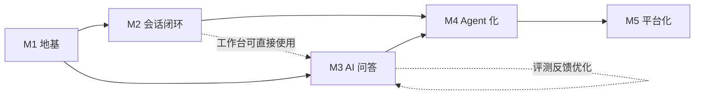

# 大型 AI Agent 智能客户应用 — 工程设计与开发规划

> 文档版本：v1.0 ｜ 日期：2026-10-11 ｜ 状态：待评审
>
> 配套文档：[架构设计](./架构设计.md) ｜ [技术选型与架构设计方案](./技术选型与架构设计方案.md)
>
> 技术栈：Go 网关 + Java 业务 + Python AI + Vue3 前端 ｜ Monorepo 管理

---

## 目录

1. [工程总览](#一工程总览)
2. [Monorepo 目录结构](#二monorepo-目录结构)
3. [各工程结构详解](#三各工程结构详解)
4. [代码规范与质量约束](#四代码规范与质量约束)
5. [开发里程碑详细规划](#五开发里程碑详细规划)
6. [里程碑依赖关系与关键路径](#六里程碑依赖关系与关键路径)
7. [交付闭环规范](#七交付闭环规范)
8. [附录：开发环境与工具链](#八附录开发环境与工具链)

---

## 一、工程总览

### 1.1 管理方式：Monorepo

采用单仓库多工程（Monorepo）管理，理由：

- 跨语言契约（Proto/OpenAPI）变更与联调在同一仓库内闭环，配套契约测试
- 一条 CI 流水线串起全部构建与测试，统一版本发布
- 支持原子提交：一个功能改动涉及多语言时一次提交完成

### 1.2 顶层工程划分

| 工程 | 语言/技术 | 定位 | 入口端口（规划） |
|---|---|---|---|
| `gateway-go` | Go 1.22+ / Gin | 接入网关、WSS/SSE 长连接 | 8080 (HTTP/WSS) |
| `core-java` | JDK 21 / Spring Boot 3.3 | 业务中枢（DDD 多域） | 8081 (gRPC/HTTP) |
| `ai-python` | Python 3.12 / FastAPI | AI 大脑（Agent/RAG/LLM 网关） | 8082 (gRPC/HTTP) |
| `web-vue3` | Vue3 + Vite + TS | 用户端 / 工作台 / 管理台 / Studio | 3000 (dev) |
| `deploy` | Helm / Docker | 多云与私有化交付 | - |
| `ops` | Prometheus/Grafana/Loki | 可观测性 | - |

### 1.3 跨语言契约管理

- **gRPC**：契约统一放 `gateway-go/proto` 与 `ai-python/proto`（单源生成，Java 侧用 `buf` 或 protobuf 插件生成）
- **REST/OpenAPI**：Java 域对外 API 以 OpenAPI 3 定义，前端据此生成 TS 类型（openapi-typescript）
- **事件契约**：Kafka 事件消息以 JSON Schema（Avro 可选）定义，契约测试（Pact）保证跨域兼容

---

## 二、Monorepo 目录结构

```
lingxi_agent/
├── docs/                        # 设计文档（本目录）
├── gateway-go/                  # Go 接入网关
├── core-java/                   # Java 业务域
├── ai-python/                   # Python AI 域
├── web-vue3/                    # Vue3 前端
├── deploy/                      # Helm Charts / 离线安装包 / 环境配置
├── ops/                         # 可观测性配置
├── scripts/                     # 工程脚本（初始化/生成/发布）
│   ├── init-repo.sh
│   ├── gen-proto.sh
│   └── build-all.sh
├── .github/
│   └── workflows/               # CI 流水线
│       ├── ci-gateway-go.yml
│       ├── ci-core-java.yml
│       ├── ci-ai-python.yml
│       ├── ci-web-vue3.yml
│       └── ci-e2e.yml
├── Makefile                     # 顶层命令入口（make build/test/dev）
├── docker-compose.dev.yml       # 本地开发依赖（MySQL/Redis/ES/Kafka）
├── .editorconfig
├── .gitignore
└── README.md
```

---

## 三、各工程结构详解

### 3.1 `gateway-go`（Go 接入网关）

```
gateway-go/
├── cmd/
│   └── gateway/main.go          # 启动入口
├── internal/
│   ├── config/                  # 配置加载（env + yaml）
│   ├── middleware/              # 鉴权/限流/审计中间件
│   │   ├── auth.go              # JWT + 租户上下文
│   │   ├── ratelimit.go         # 令牌桶限流
│   │   ├── circuit.go           # 滑动窗口熔断
│   │   └── accesslog.go         # 访问审计
│   ├── handler/                 # HTTP 处理器（REST 转发）
│   ├── ws/                      # 长连接管理
│   │   ├── hub.go               # 连接注册表（百万级）
│   │   ├── session.go           # 会话映射与粘性路由
│   │   └── buffer.go            # 断连缓冲（30s, seq 续传）
│   ├── client/                  # 出站客户端
│   │   ├── java_grpc.go         # → Java 会话域
│   │   └── python_grpc.go       # → Python 同步通道
│   ├── kafka/                   # 事件生产/消费（ai.answer.chunk）
│   ├── auth/                    # JWT 签发/校验
│   └── metric/                  # Prometheus 指标
├── proto/                       # gRPC 契约（单源）
│   ├── session.proto
│   └── ai.proto
├── tests/                       # 单测 + 集成测试
├── go.mod
├── Makefile
└── Dockerfile
```

**职责边界**：网关不持有任何业务逻辑，仅做协议转换、流量治理与消息转发；所有业务校验收敛到 Java 域。

### 3.2 `core-java`（Java 业务域，DDD）

```
core-java/
├── pom.xml                       # 父 POM（依赖版本统一管理）
├── common/                       # 通用模块
│   └── src/main/java/.../common/ # 统一响应/异常/分页/工具/基类
├── gateway-api/                  # 对外契约（OpenAPI + 事件定义）
├── user/                         # 用户/租户/权限域
│   └── src/main/java/.../user/
│       ├── api/                  # 控制器/入参出参 DTO
│       ├── application/          # 应用服务（用例编排）
│       ├── domain/               # 实体/值对象/领域服务/仓储接口
│       └── infrastructure/       # MyBatis-Plus 实现/Redis/事件发布
├── session/                      # 会话域（状态机核心）
├── ticket/                       # 工单域（Seata 事务）
├── knowledge/                    # 知识库域
├── report/                       # 报表域（ClickHouse）
├── notify/                       # 通知域
└── start/                        # 启动聚合模块（装配各域）
    └── src/main/resources/
        ├── application.yml
        └── db/migration/         # Flyway 数据库脚本
```

**DDD 分层约束**：`domain` 不依赖 `infrastructure`（依赖倒置），事件发布统一走 `application` 层。

### 3.3 `ai-python`（Python AI 域）

```
ai-python/
├── pyproject.toml                # uv/poetry 依赖管理
├── app/
│   ├── main.py                   # FastAPI 入口（含 gRPC 服务）
│   ├── config.py                 # Pydantic Settings（全环境变量化）
│   ├── api/                      # REST 路由（健康检查/评测触发）
│   ├── gateway/                  # LLM 网关（双通道共用）
│   │   ├── router.py             # 模型路由策略
│   │   ├── providers/            # deepseek.py / qwen.py / glm.py / kimi.py / openai.py
│   │   ├── retry.py              # 指数退避重试
│   │   └── degrade.py            # 降级切换
│   ├── agent/                    # Agent 运行时
│   │   ├── graph.py              # LangGraph 图定义
│   │   ├── state.py              # 对话状态/上下文
│   │   ├── handoff.py            # 人工接管判定（置信度/规则）
│   │   └── tools/                # 工具定义与执行器（JSON Schema 校验）
│   │       ├── registry.py
│   │       ├── order.py          # 查订单（调 Java 域）
│   │       └── logistics.py
│   ├── rag/
│   │   ├── ingest.py             # 文档解析/分块/Embedding
│   │   ├── retrieve.py           # BM25 + kNN 混合检索
│   │   └── rerank.py             # bge-reranker 精排
│   ├── memory/                   # 长程记忆摘要
│   ├── desensitize/              # PII 脱敏（正则 + 实体识别）
│   ├── consumers/                # Kafka 异步通道消费
│   │   ├── session_message.py
│   │   └── batch_task.py
│   ├── evaluator/                # Golden Set 评测与回归
│   └── metrics.py                # Prometheus 指标
├── proto/                        # gRPC 契约（ai.proto 等）
├── tests/                        # pytest 单测 + 集成
├── Dockerfile
└── Makefile
```

**关键约束**：AI 域不直连业务库；LLM 调用统一走 `gateway`，禁止绕过。

### 3.4 `web-vue3`（前端）

```
web-vue3/
├── package.json
├── vite.config.ts
├── src/
│   ├── main.ts
│   ├── router/                   # 权限路由（用户端/工作台/管理台/Studio）
│   ├── stores/                   # Pinia：auth / session / workbench
│   ├── api/                      # 请求封装（axios + 类型生成）
│   │   ├── http.ts
│   │   ├── sse.ts                # ReadableStream 流式渲染
│   │   └── wss.ts                # 实时长连接封装
│   ├── views/
│   │   ├── portal/               # 用户端会话页
│   │   ├── workbench/            # 客服工作台（会话列表/消息/接管/工单）
│   │   ├── admin/                # 管理后台（租户/用户/知识库/权限）
│   │   └── studio/               # Agent 编排 Studio（拖拽画布）
│   ├── components/               # 通用组件（消息气泡/流式渲染/图表）
│   ├── composables/              # useChatStream / useSocket / useTicket
│   └── types/                    # OpenAPI 生成类型 + 领域类型
├── tests/                        # Vitest 单测 + Playwright E2E
└── Dockerfile
```

### 3.5 `deploy`（部署交付）

```
deploy/
├── helm/
│   ├── gateway-go/               # Go 网关 Chart
│   ├── core-java/                # Java 业务 Chart（多域子模板）
│   ├── ai-python/                # AI 域 Chart
│   ├── web-vue3/                 # 前端 Chart
│   └── infra/                    # 中间件 Chart（mysql/redis/es/kafka/clickhouse）
├── offline/                      # 私有化离线交付
│   ├── images/                   # 镜像 tar 包 + 导入脚本
│   ├── charts/                   # 打包好的 Helm 依赖
│   └── installer.sh              # 一键安装器
├── values/
│   ├── dev/                      # 环境差异配置
│   ├── staging/
│   └── prod/
└── k8s/                          # 公共资源（namespace/secret/ingress）
```

### 3.6 `ops`（可观测性）

```
ops/
├── prometheus/                   # 采集规则 + 告警规则（alertmanager）
├── grafana/                      # 面板 JSON（三语言全链路大盘）
├── loki/                         # 日志采集与检索
├── otel/                         # OpenTelemetry Collector 配置
└── loadtest/                     # 压测脚本（k6：对话/长连接场景）
```

---

## 四、代码规范与质量约束

### 4.1 各语言规范

| 语言 | 规范 | 静态检查 | 格式化 |
|---|---|---|---|
| Java | 《阿里巴巴 Java 开发手册》 | Checkstyle + SpotBugs | google-java-format |
| Go | Effective Go + 官方风格 | golangci-lint | gofmt / goimports |
| Python | PEP 8 | Ruff + Pylint | Ruff format / Black |
| TypeScript/Vue | 阿里前端规范 | ESLint + Vue 官方插件 | Prettier |

### 4.2 通用约束

- **命名**：领域术语统一（会话/工单/接管/知识/Agent 任务），禁用无意义缩写与单字母变量
- **提交规范**：Conventional Commits（`feat`/`fix`/`refactor`/`docs`/`test`/`chore`）
- **分支策略**：trunk-based（主干开发 + 短特性分支 + PR 评审），发布打 tag
- **测试要求**：
  - 单元测试：核心逻辑覆盖率 ≥ 70%（Java/Python/Go 关键路径）
  - 契约测试：跨语言接口全部 Pact 覆盖
  - Golden Set：AI 回答质量回归数据集持续维护
- **配置安全**：密钥/Token 一律环境变量 + Secret 管理，禁止硬编码进代码与镜像

---

## 五、开发里程碑详细规划

> 里程碑顺序依赖：M1 → M2 → M3 → M4 → M5。M2/M3 存在并行窗口（前端工作台与 AI 链路可分别推进）。

### 5.1 M1 地基 — 工程骨架与基础设施

**目标**：仓库、CI、本地开发环境就绪，四语言骨架可运行，跨语言链路打通（ping/health）。

**任务拆解**

| # | 任务 | 域 | 产出与验收 |
|---|---|---|---|
| 1.1 | Monorepo 初始化、Makefile、git 规范、README | 全体 | 仓库可 `make dev` 一键拉起 |
| 1.2 | docker-compose.dev：MySQL/Redis/ES/Kafka | 运维 | 本地中间件一键启动，健康检查通过 |
| 1.3 | Go 网关骨架 | Go | `/health`、JWT 中间件、限流中间件、访问日志；golangci-lint 通过 |
| 1.4 | Java 骨架 | Java | 多模块（common/各域空壳）、统一响应/异常、Nacos 注册、Flyway 基线脚本；Checkstyle 通过 |
| 1.5 | Python 骨架 | Python | FastAPI 启动、Pydantic Settings、健康检查；Ruff/Pylint 通过 |
| 1.6 | Vue3 骨架 | 前端 | Vite 工程、路由、Pinia、Naive UI 接入、请求封装（含 SSE 测试页）；ESLint 通过 |
| 1.7 | LLM 网关最小实现 | AI | 接入 DeepSeek 非流式调用 + 超时/重试/降级框架，单测覆盖降级路径 |
| 1.8 | gRPC 契约与骨架连通 | Go/Java/Python | 网关→Java 域 ping 通；契约测试（Pact）跑通 |
| 1.9 | CI 流水线 | 运维 | 四个语言 CI Job 全绿（静态检查 + 单测 + 镜像构建） |
| 1.10 | Helm 基础 Chart + dev 环境 | 运维 | 四服务 + 中间件可部署到 dev K8s |

**里程碑验收**：`make build && make test` 全绿；dev 环境四服务健康检查通过；网关 → Java → Python 链路 ping 通。

### 5.2 M2 会话闭环 — 人工客服 MVP

**目标**：无 AI 情况下完成「用户咨询 → 人工客服 → 工单」全闭环，验证会话状态机与事件链路。

**任务拆解**

| # | 任务 | 域 | 产出与验收 |
|---|---|---|---|
| 2.1 | 会话域状态机 | Java | 状态机（INIT/HUMAN_CHAT/CLOSED）+ 事件发布；边界：重复关闭、非法迁移被拒绝 |
| 2.2 | 消息落库与查询 | Java | 消息按月分表，游标分页查询；边界：超大会话分页性能 |
| 2.3 | WSS 长连接网关 | Go | 会话粘性路由、心跳、断连缓冲 30s + seq 续传；边界：断连重连消息不丢不重 |
| 2.4 | 客服队列与接管 | Java | 排队/分配/抢单，事件经 Kafka 通知工作台；边界：并发抢单只成功一次 |
| 2.5 | 工单域 | Java | 工单创建/流转/关闭，Seata AT 事务；边界：并发更新冲突回滚 |
| 2.6 | 客服工作台 | 前端 | 会话列表（实时）、消息区、快捷回复、一键建单 |
| 2.7 | 用户端会话页 | 前端 | 发消息、收消息、重连恢复 |
| 2.8 | 集成测试 | 全体 | 两坐席 + 一用户端联调；E2E：接管→会话→工单全流程 |

**里程碑验收**：端到端「用户咨询 → 坐席接管 → 会话 → 建单」走通；断连重连无消息丢失；并发抢单幂等。

### 5.3 M3 AI 问答 — LLM + RAG 流式链路

**目标**：AI 能基于知识库回答用户问题，流式输出贯通，具备评测与降级能力。

**任务拆解**

| # | 任务 | 域 | 产出与验收 |
|---|---|---|---|
| 3.1 | LLM 网关完整版 | AI | 多模型路由（DeepSeek 主/qwen 备）、首字 10s/总 120s 超时、指数退避、降级切换；故障演练通过 |
| 3.2 | 知识库管理 | Java | 知识分类/文档上传/版本；边界：超大文档分片上传、权限校验 |
| 3.3 | 文档解析与向量化 | AI | PDF/Word/MD 解析 → 分块 → Embedding → ES 索引（异步任务队列） |
| 3.4 | 混合检索 + Rerank | AI | BM25+kNN 召回 Top20 → bge-reranker 精排 Top5；单测断言召回质量 |
| 3.5 | Agent 运行时最小图 | AI | LangGraph：加载上下文 → 检索 → 生成（非流式先通） |
| 3.6 | 流式全链路 | Go/Python/Java | Python 流式 → Kafka chunk → Go WSS → 前端打字机；端到端首字 < 800ms |
| 3.7 | PII 脱敏 | AI | 手机/证件/地址脱敏进模型 + 答案还原；边界：占位符冲突、嵌套场景 |
| 3.8 | 评测中心 v1 | AI | Golden Set 20+ 用例回归、Badcase 记录 |
| 3.9 | 对话状态机 AI 化 | Java/Python | AI_ACTIVE 状态、上下文窗口管理（近 N 轮 + 摘要） |

**里程碑验收**：知识库 QA 准确率达标（Golden Set）；流式首字延迟达标；模型故障降级不中断会话；脱敏用例全过。

### 5.4 M4 Agent 化 — 工具调用与编排

**目标**：Agent 具备工具调用、记忆、人工接管联动，运营侧可编排工作流。

**任务拆解**

| # | 任务 | 域 | 产出与验收 |
|---|---|---|---|
| 4.1 | 工具框架 | AI | Function Calling + JSON Schema 强校验 + 白名单；非法参数被拒 |
| 4.2 | 业务工具接入 | AI/Java | 查订单/查物流/退换货（先 mock 后接 Java 域 gRPC）；超时 5s + 重试 1 次 + 降级话术 |
| 4.3 | 工具审计 | AI | 调用全量审计（入参/结果/耗时/费用） |
| 4.4 | 记忆管理 | AI | 长程摘要生成、跨会话记忆注入（按租户/会话隔离） |
| 4.5 | 人工接管联动 | AI/Java/Python | 低置信度/用户要求/情绪规则触发接管，上下文摘要移交；边界：接管瞬间正在生成的回答终止 |
| 4.6 | 同步通道（坐席快捷回复） | Java/Python | gRPC 同步 + 独立线程池信号量（32）+ 超时 5s + 超载降级异步；压测验证线程池不泄漏 |
| 4.7 | 编排 Studio | 前端 | 拖拽节点（LLM/检索/工具/分支）、配置、发布版本；画布状态可回滚 |
| 4.8 | Agent 运行时多工作流 | AI | 按工作流版本加载图，路由版本灰度 |

**里程碑验收**：工具链路（调用→校验→执行→回填→审计）完整；接管全流程自动化；同步通道降级演练通过；Studio 可发布并灰度一套工作流。

### 5.5 M5 平台化 — 报表、容灾与交付

**目标**：运营分析完备，多云双活与私有化交付可用，系统达到生产级性能与稳定性。

**任务拆解**

| # | 任务 | 域 | 产出与验收 |
|---|---|---|---|
| 5.1 | 数据分析管道 | Java/AI | 会话漏斗/满意度/Token 消耗 → ClickHouse → 报表页面 |
| 5.2 | 全链路压测 | 运维 | k6 压测（对话/长连接）；QPS 5000+ / 50 万连接达标，识别并修复瓶颈 |
| 5.3 | 多云双活演练 | 运维 | 主 Region 故障切换演练，RTO < 5min、数据零丢失 |
| 5.4 | 私有化交付包 | 运维 | 离线镜像 + Helm 打包 + 一键安装器；客户内网全流程验证 |
| 5.5 | 租户隔离加固 | Java | 大租户独立资源组、数据隔离审计 |
| 5.6 | 运营后台完善 | 前端/Java | 权限体系、操作审计、知识库运营视图 |
| 5.7 | 安全加固 | 全体 | 依赖漏洞扫描、接口渗透测试、Prompt 注入防护用例 |

**里程碑验收**：压测与容灾指标达标；私有化交付在干净内网环境一键部署成功；安全测试问题清零。

---

## 六、里程碑依赖关系与关键路径



**关键路径**：M1 → M2 → M4 → M5（会话能力先行，Agent 构建于稳定会话链路上）；M3 与 M2 可并行推进（AI 检索链路独立于人工客服链路）。

**提前预警的风险点**：

| 风险 | 里程碑 | 规避 |
|---|---|---|
| Kafka 事件契约漂移 | M2/M3 | 契约测试（Pact）纳入 CI，事件 Schema 变更必须双端同步 |
| 流式链路延迟劣化 | M3 | 提前埋点（分跳耗时），设定首字延迟 SLO 与告警 |
| LangGraph 版本升级破坏图 | M4 | 锁定版本 + Golden Set 回归防线 |
| 多云同步数据冲突 | M5 | 双主冲突策略（按租户分主）提前设计 |
| 私有化离线部署差异 | M5 | 从 M1 起所有服务无外网依赖（除模型 API 外） |

---

## 七、交付闭环规范

每个里程碑交付时，除代码外必须同步提供：

| 交付物 | 要求 | 示例 |
|---|---|---|
| 部署步骤 | 从零到可运行的命令序列 | `helm install ...` / `./installer.sh` |
| 测试用例 | 含边界条件与异常路径 | 断连重连、并发抢单、降级演练、非法参数 |
| 使用说明 | 各工程 README：启动方式、配置项、接口清单 | `gateway-go/README.md` 等 |
| 契约清单 | 跨语言接口与事件定义变更记录 | proto 变更、事件 Schema 版本 |

**验收门槛（DoD）**：静态检查通过 + 单测覆盖达标 + 契约测试绿 + 关键路径集成测试通过 + 文档就绪。

---

## 八、附录：开发环境与工具链

| 工具 | 版本 | 用途 |
|---|---|---|
| JDK | 21 (LTS) | Java 运行 |
| Go | 1.22+ | 网关开发 |
| Python | 3.12 | AI 域开发 |
| Node.js | 20 LTS | 前端构建 |
| Docker / Compose | 24+ | 本地环境与镜像 |
| Kubernetes / kubectl | 1.28+ | 部署目标 |
| Helm | 3.x | 应用打包 |
| ArgoCD | 2.x | GitOps |
| buf / protoc | 最新 | 契约生成 |
| k6 | 最新 | 压测 |
| IDEs | VS Code（Go/Python/前端）+ IDEA（Java） | 开发 |

---

> 本文档将随架构调整与里程碑推进持续更新。
