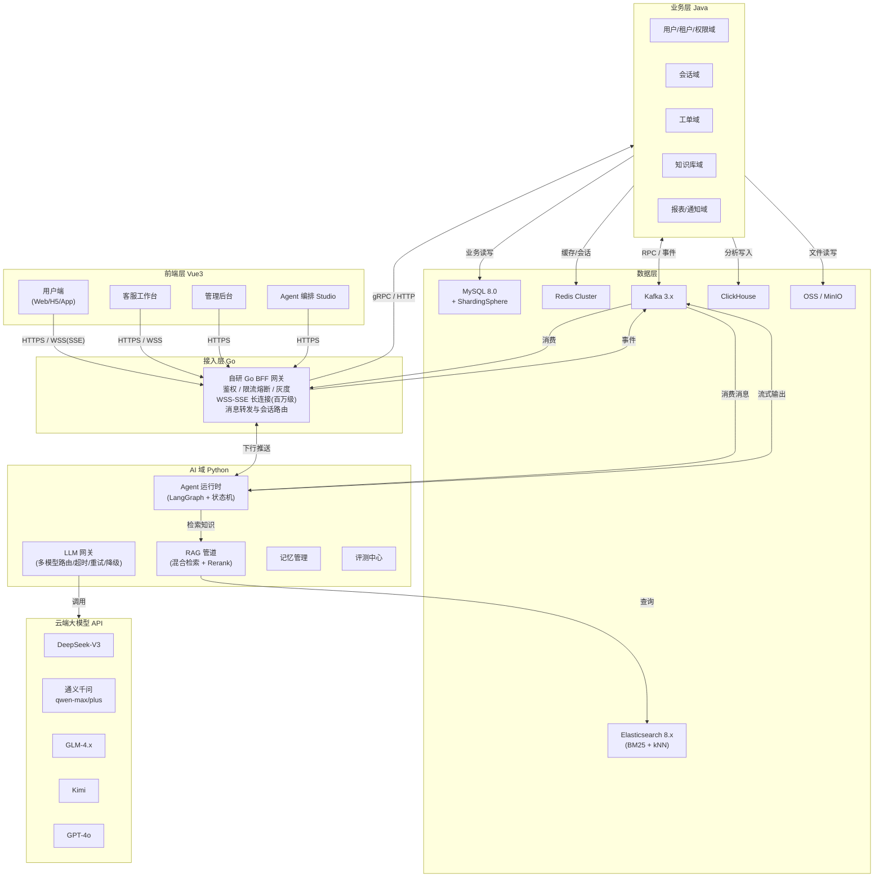
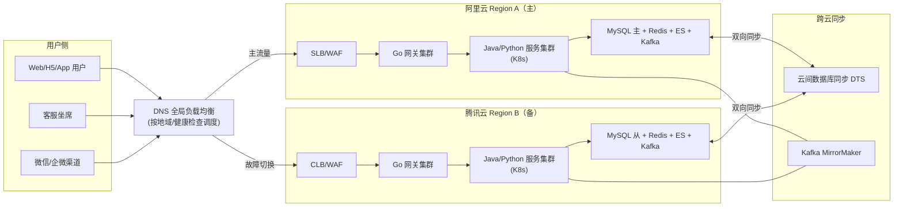
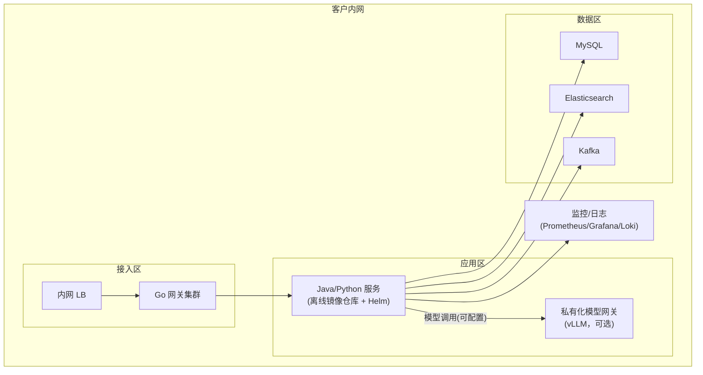
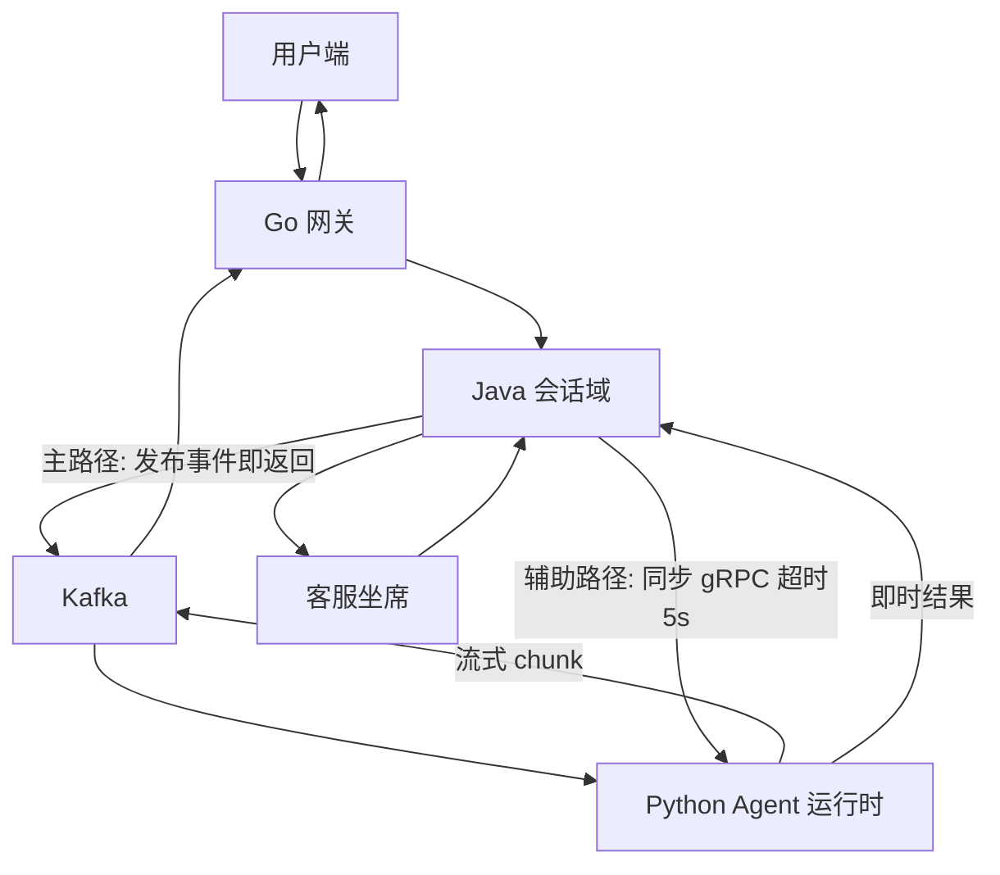
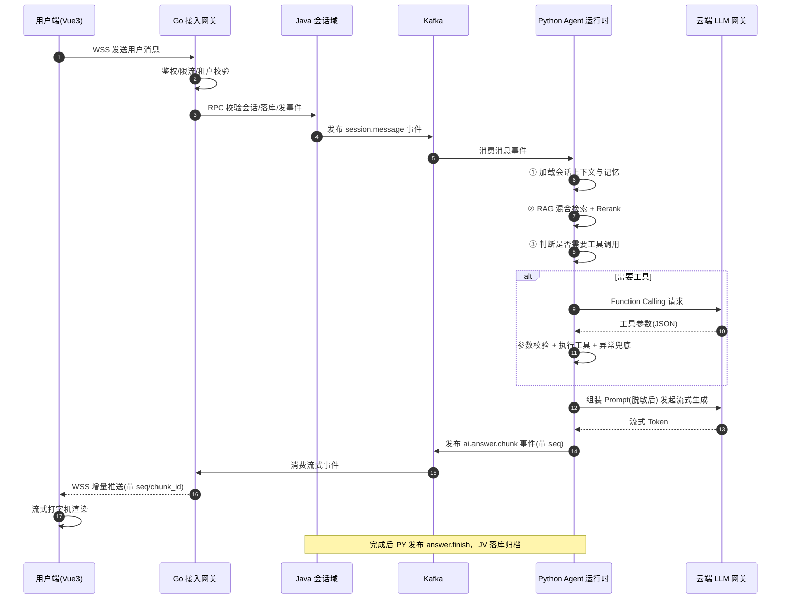
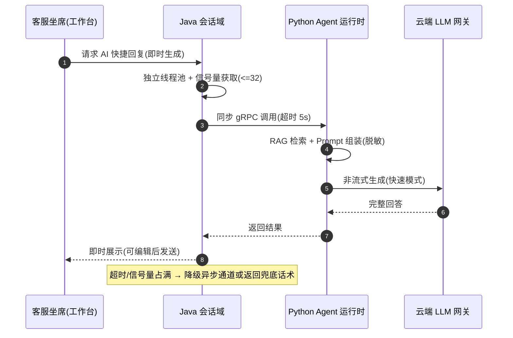
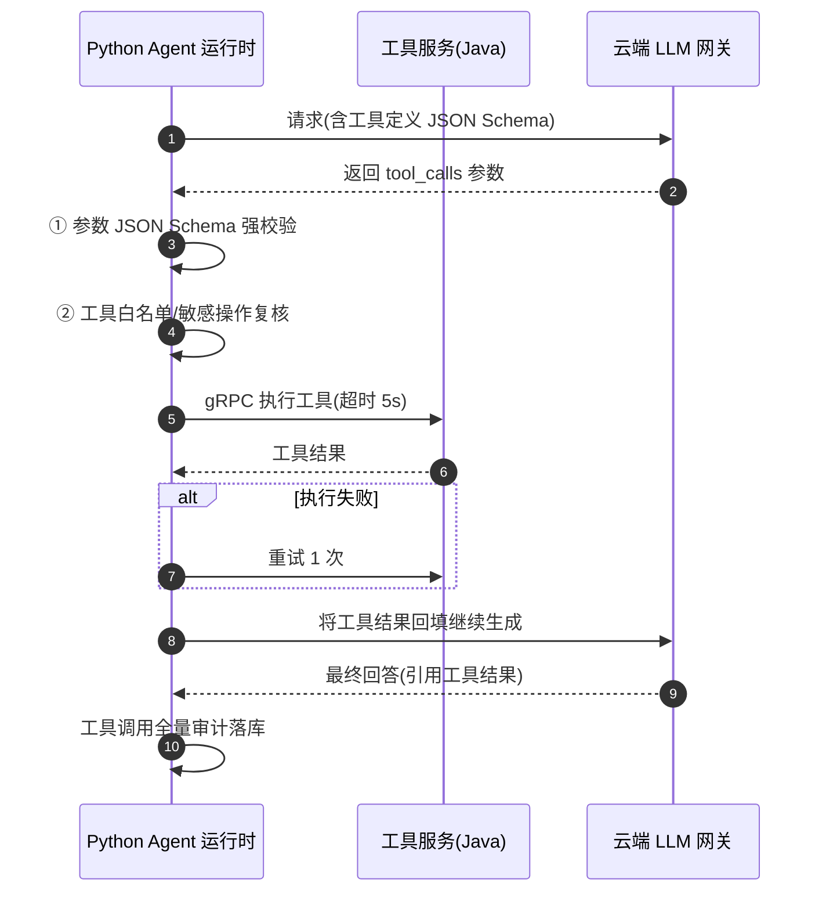
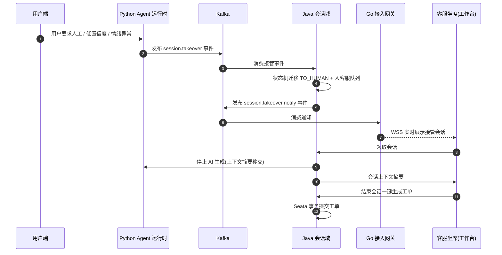

# 大型 AI Agent 智能客户应用 — 架构设计

> 文档版本：v1.0 ｜ 日期：2026-10-11 ｜ 状态：待评审
>
> 配套文档：[技术选型与架构设计方案](./技术选型与架构设计方案.md)
>
> 技术栈：Java + Go + Python + Vue3 ｜ 业务形态：混合形态（智能客服 + Agent 编排）
> 规模目标：百万级用户 / QPS 5000+ / 多云容灾 + 私有化交付并存

> 说明：本文档中的架构图、时序图、拓扑图均采用 Mermaid 语法绘制，可在支持 Mermaid 的编辑器（VS Code + Markdown Preview Mermaid、Typora、语雀、GitHub）中直接渲染查看。

---

## 目录

1. [设计目标与约束](#一设计目标与约束)
2. [总体技术架构](#二总体技术架构)
3. [分层架构详解](#三分层架构详解)
4. [网络拓扑架构](#四网络拓扑架构)
5. [核心链路时序](#五核心链路时序)
   - [调用模式选型决策（异步为主 + 同步兜底）](#51-调用模式选型决策异步为主--同步兜底)
   - [一次完整对话链路（异步主路径）](#52-一次完整对话链路异步主路径)
   - [同步调用链路（低延迟场景）](#53-同步调用链路低延迟场景)
   - [工具调用链路](#54-工具调用链路)
   - [人工接管链路](#55-人工接管链路)
6. [技术栈详解](#六技术栈详解)
7. [数据架构与存储设计](#七数据架构与存储设计)
8. [部署与运维架构](#八部署与运维架构)
9. [性能与可用性设计](#九性能与可用性设计)
10. [附录：关键术语](#十附录关键术语)

---

## 一、设计目标与约束

### 1.1 业务目标

- **智能客服核心**：多渠道接入（Web/H5/App/微信/企微）、多轮对话、RAG 知识问答、情绪识别、人工接管、工单闭环
- **Agent 编排能力**：运营侧低代码编排 Agent 工作流（工具调用、条件分支、定时触发）

### 1.2 非功能目标

| 指标 | 目标 |
|---|---|
| 规模 | 百万级注册用户，日对话峰值 QPS 5000+ |
| 长连接 | 50 万+ 并发会话（WSS/SSE） |
| 首字延迟 | < 800ms |
| 工具调用超时 | < 5s |
| 可用性 | 99.99%（多云双活容灾 + 私有化交付并存） |
| 数据合规 | PII 脱敏进模型、租户隔离、全链路审计 |

### 1.3 架构设计原则

| 原则 | 说明 |
|---|---|
| 单向依赖 | 前端 → Go 网关 → Java 业务域 / Python AI 域，事件经 Kafka 异步解耦，避免循环调用 |
| 事件驱动 | 会话/消息/工单/审计全部事件化，异步削峰、故障隔离 |
| AI 域隔离 | Python AI 域不直连业务库，仅通过 RPC/事件交互，保障业务数据安全边界 |
| 无状态化 | 连接无状态，会话状态收敛至 Redis + Java 域落库，支持水平扩展与秒级滚动发布 |
| 多云可移植 | 全容器化 + Helm 统一交付，公有云与私有化部署同构 |

---

## 二、总体技术架构



### 核心设计说明

1. **单一网关入口**：所有南北流量统一经 Go 网关，负责鉴权、限流、长连接与消息转发，业务域不直接暴露。
2. **异步消息总线**：跨域协作（Java ↔ Python、Python → Go 下行推送）全部走 Kafka，实现削峰、解耦与故障隔离。
3. **模型接入统一**：Python 域通过 LLM 网关统一接入多家云端模型，按路由策略分级调度，故障自动降级。

---

## 三、分层架构详解

### 3.1 接入层（Go）

| 职责 | 说明 |
|---|---|
| 协议接入 | HTTPS 短连接 + WSS/SSE 长连接，单实例支撑 10 万+ 连接 |
| 鉴权与租户 | JWT 校验、租户上下文注入、接口级 RBAC 鉴权 |
| 流量治理 | 令牌桶限流、滑动窗口熔断、灰度发布（按租户/用户 hash） |
| 会话路由 | 按租户 hash 路由至 Java 会话域实例，保证会话粘性 |
| 消息完整性 | 增量消息携带 `seq` + `chunk_id`，断连重连断点续拉（本地缓冲 30s） |

### 3.2 业务层（Java）

| 领域模块 | 核心能力 |
|---|---|
| 用户/租户/权限域 | 账号体系、租户隔离、RBAC 权限、操作审计 |
| 会话域 | 会话状态机、会话上下文持久化、接管队列、排队调度 |
| 工单域 | 工单创建/流转/关闭，Seata 分布式事务保障一致性 |
| 知识库域 | 知识分类、文档管理、知识版本、向量化任务调度 |
| 报表/通知域 | 会话漏斗、满意度、Token 消耗统计、消息通知 |

### 3.3 AI 域（Python）

| 模块 | 核心能力 |
|---|---|
| 调用入口（双通道） | 异步通道：Kafka 消费（会话消息、批量任务）；同步通道：gRPC 服务（低延迟场景），均统一进入 Agent 运行时 |
| LLM 网关 | 多模型路由、超时控制（首字 10s/总 120s）、指数退避重试（3 次）、降级切换、Token 审计 |
| Agent 运行时 | LangGraph 图式编排 + 自研会话状态机，控制工具调用、条件分支、人工接管 |
| RAG 管道 | Query 改写 → 混合检索（BM25 + kNN）→ Rerank（bge-reranker，Top20→Top5）→ 拼装 Context |
| 记忆管理 | 近期 N 轮 + 检索知识 + 长程记忆摘要（分层压缩），按会话隔离 |
| 评测中心 | Golden Set 回归、回答质量评分、幻觉检测、线上 Badcase 回流 |

### 3.4 数据层

| 组件 | 定位 |
|---|---|
| MySQL + ShardingSphere | 业务主库，会话/工单按租户+时间分片 |
| Redis Cluster | 会话状态缓存、限流计数、分布式锁、断连缓冲 |
| Elasticsearch 8.x | 全文检索 + 向量检索（kNN）一体，知识库与对话消息索引、日志检索 |
| Kafka | 事件总线（会话/消息/工单/审计事件、AI 流式输出） |
| ClickHouse | 分析报表（漏斗、满意度、Token 审计） |
| OSS/MinIO | 文件与知识库附件存储 |

### 3.5 前端层（Vue3）

| 应用 | 说明 |
|---|---|
| 用户端（Web/H5/App WebView） | 会话界面、流式打字机渲染、消息重连恢复 |
| 客服工作台 | 实时会话列表、人工接管、快捷回复、工单一键生成 |
| 管理后台 | 租户/用户/知识库/权限管理、报表可视化（ECharts） |
| Agent 编排 Studio | 拖拽式工作流编排、工具配置、版本发布 |

---

## 四、网络拓扑架构

### 4.1 公有云多活拓扑（阿里云 + 腾讯云双活）



### 4.2 私有化交付拓扑



**说明**：私有化交付与公有云部署架构同构（同一套 Helm Charts），差异仅在于模型网关地址可指向私有化 vLLM，满足数据不出域要求。

---

## 五、核心链路时序

### 5.1 调用模式选型决策（异步为主 + 同步兜底）

**背景**：LLM 生成是「慢且贵」的依赖（秒级~分钟级、按 Token 计费）。若 Java 同步调用 Agent 层，AI 生成期间 Java 的线程/连接会被长期占用，毫秒级的业务接口（工单/报表/知识库 CRUD）会被慢依赖拖垮，故主路径选择 Kafka 异步事件驱动。

#### 两种模式对比

| 考量点 | 异步（Kafka，主路径） | 同步（gRPC，辅助） |
|---|---|---|
| 慢依赖隔离 | ✅ Java 发完事件即释放线程，AI 慢不影响业务快 | ❌ AI 生成期间 Java 线程被占用 |
| 削峰填谷 | ✅ LLM 高峰消息在 Kafka 排队，平滑消费 | ❌ 高峰只能排队/拒绝 |
| 容错重放 | ✅ 消费失败可重放、幂等消费 | ❌ 失败即返回，需调用方兜底 |
| 流式输出 | ✅ chunk 事件流天然匹配 | ⚠️ 需占用长连接原路回传 |
| 扩缩容 | ✅ 两侧独立扩缩容 | ⚠️ 强耦合，需同步调限流 |
| 实现复杂度 | 中（幂等、事件建模） | 低（调用栈直达） |

#### 混合共存的路由规则

| 场景 | 模式 | 说明 |
|---|---|---|
| 用户端对话（高并发、流式） | 异步（主） | 用户 → Go 网关 → Java 落库 → Kafka → Agent → 流式回传 |
| 坐席 AI 快捷回复（内部低频、需即时结果） | 同步（辅助） | Java 直连 Agent gRPC，超时 5s 快速失败 |
| 批量任务（知识向量化、离线评测） | 异步 | Kafka 队列削峰，失败重试 |
| 定时触发的 Agent 工作流 | 异步 | 事件触发，不阻塞主链路 |

#### 同步通道的隔离约束（强制）

- **线程池隔离**：Java 侧为 AI 同步调用单独分配线程池 + 信号量（如 32 并发），禁止占用公共业务线程池
- **超时快速失败**：同步调用超时 5s，超时即返回兜底话术，不无限等待
- **降级一致性**：同步通道超载（信号量占满）时自动降级为异步通道，保证请求不丢
- **双通道复用**：两条通道最终都进入同一 Agent 运行时与 LLM 网关，逻辑唯一、仅差异通道

#### 混合模式示意图



### 5.2 一次完整对话链路（异步主路径）



### 5.3 同步调用链路（低延迟场景）

适用于坐席 AI 快捷回复等内部低频、需即时结果的场景，走同步 gRPC 并强制隔离约束。



### 5.4 工具调用链路（Function Calling）



### 5.5 人工接管链路



---

## 六、技术栈详解

### 6.1 前端层

| 技术组件 | 版本（主要） | 用途 | 关键设计 |
|---|---|---|---|
| Vue 3 | 3.x | 前端框架 | 组合式 API，`<script setup>` |
| Vite | 5.x+ | 构建工具 | 开发热更新、生产分包 |
| TypeScript | 5.x | 类型安全 | 严格模式，接口类型由 OpenAPI 生成 |
| Pinia | 2.x/3.x | 状态管理 | 会话状态、用户态、路由守卫 |
| Vue Router | 4.x | 路由 | 权限路由、动态菜单 |
| Naive UI | 2.x | UI 组件库 | 工作台/Studio 重交互场景 |
| ECharts | 5.x | 可视化 | 报表图表 |
| XState（可选） | 5.x | 前端状态机 | 复杂交互状态建模 |

**流式渲染**：`fetch + ReadableStream` 逐 chunk 解析 SSE 增量，实现打字机效果；WSS 通道负责实时会话消息与坐席事件推送。

### 6.2 接入层（Go）

| 技术组件 | 版本（主要） | 用途 | 关键设计 |
|---|---|---|---|
| Go | 1.22+ | 开发语言 | 协程模型支撑百万级长连接 |
| Gin | 1.10.x | HTTP 框架 | 路由中间件（鉴权/限流/审计） |
| gorilla/websocket | 1.5.x | WebSocket 长连接 | 或选 gnet 提升性能 |
| gRPC-Go | 1.6x.x | 与 Java 域 RPC | Proto 契约，双向流 |
| JWT | golang-jwt/jwt/v5 | 认证 | 无状态 Token + 租户声明 |
| Redis client | go-redis/v9 | 会话/限流 | 令牌桶计数、断连缓冲 |
| Prometheus client | 1.x | 指标暴露 | QPS/延迟/连接数/错误率 |

### 6.3 业务层（Java）

| 技术组件 | 版本（主要） | 用途 | 关键设计 |
|---|---|---|---|
| JDK | 21 (LTS) | 运行环境 | 虚拟线程提升 IO 并发 |
| Spring Boot | 3.3.x | 应用框架 | 模块化多域 |
| Spring Cloud Alibaba | 2023.x | 微服务套件 | Nacos 注册配置中心 |
| Nacos | 2.x | 注册/配置 | 服务发现、动态配置、灰度 |
| Sentinel | 1.8.x | 流量治理 | 熔断/限流/热点防护兜底 |
| Seata | 1.8.x | 分布式事务 | 工单跨域事务 AT 模式 |
| ShardingSphere | 5.x | 分库分表 | 会话/工单按租户+时间分片 |
| MyBatis-Plus | 3.5.x | ORM | 单表 CRUD 简化 |
| OpenFeign | 4.x | 服务调用 | Java 域内 RPC |
| gRPC | 1.6x.x | 跨语言 RPC | 与 Go/Python 契约通信 |

### 6.4 AI 域（Python）

| 技术组件 | 版本（主要） | 用途 | 关键设计 |
|---|---|---|---|
| Python | 3.12 | 开发语言 | asyncio 全异步 |
| FastAPI | 0.115+ | API 框架 | 异步高性能、Pydantic 校验 |
| LangGraph | 0.2+ | Agent 编排 | 图式工作流、可观测、断点恢复 |
| langchain-core | 0.3+ | LLM 抽象 | 统一调用接口 |
| openai SDK | 1.x | 模型接入 | 兼容 OpenAI 协议的网关直连 |
| Elasticsearch client | 8.x | 混合检索 | BM25 + kNN 混合查询 |
| sentence-transformers | 3.x | Embedding | 或调用云端 Embedding API |
| bge-reranker | - | 精排 | Top20 → Top5 |
| Pydantic | 2.x | 数据校验 | 工具参数/配置强类型 |
| Prometheus client | - | 指标暴露 | 调用成功率/延迟/Token 消耗 |

**Agent 约束**（强制）：

- 所有 LLM 调用含超时（首字 10s/总 120s）、指数退避重试（3 次）、降级（主模型失败切换备用）
- RAG 检索结果必须经 Rerank 再入生成环节
- PII 数据进入模型前必须脱敏（手机/证件/地址正则 + 自定义实体识别）
- 工具调用必须做参数校验与异常兜底
- 流式响应必须处理断连重连与消息完整性（seq 续传）

### 6.5 数据与中间件

| 组件 | 版本（主要） | 用途 | 关键设计 |
|---|---|---|---|
| MySQL | 8.0 | 业务主库 | 分库分表，Binlog 同步 |
| Redis | 7.x | 缓存/状态 | Cluster 模式，AOF 持久化 |
| Elasticsearch | 8.x | 检索 | 全文 + kNN 一体，ILM 生命周期管理 |
| Kafka | 3.6+ | 事件总线 | 分区按租户/会话 hash，至少一次语义 |
| ClickHouse | 24.x | 分析 | 列式存储，漏斗/满意度报表 |
| OSS / MinIO | - | 对象存储 | 附件、知识库文件、日志归档 |

### 6.6 部署与可观测

| 组件 | 版本（主要） | 用途 |
|---|---|---|
| Kubernetes | 1.28+ | 容器编排，多云/私有化同构 |
| Helm | 3.x | 应用打包与版本管理 |
| ArgoCD | 2.x | GitOps 持续交付 |
| Docker | 24+ | 镜像构建（多阶段构建） |
| Prometheus + Grafana | 2.x / 10.x | 指标采集与大盘 |
| Loki | 3.x | 日志聚合检索 |
| OpenTelemetry | 1.x | 全链路 Trace（Go/Java/Python 串联） |

---

## 七、数据架构与存储设计

### 7.1 数据分类与存储策略

| 数据类型 | 存储 | 分片/保留策略 |
|---|---|---|
| 用户/租户/权限 | MySQL | 按租户分片 |
| 会话状态 | Redis + MySQL | 热数据 Redis，冷数据 MySQL 归档 |
| 对话消息 | MySQL（近 N 天）+ ES（索引） | 按月分表，ES 支撑检索 |
| 工单 | MySQL（Seata 事务） | 按租户+时间分片 |
| 知识库文档 | MySQL（元数据）+ OSS（文件）+ ES（向量/全文） | 版本化管理 |
| 向量数据 | ES kNN | ILM 滚动索引 |
| 分析数据 | ClickHouse | TTL 按策略过期 |
| 审计日志 | ES / ClickHouse | 永久保留，合规审计 |

### 7.2 会话上下文管理

```
最近 N 轮对话(Redis, TTL)
        │ 超出窗口
        ▼
摘要压缩(LLM 生成) ──▶ 长程记忆(MySQL/ES)
        ▲
        │ 新会话载入
会话上下文 = 长程记忆摘要 + 最近 N 轮 + 本次检索知识
```

### 7.3 PII 脱敏管道

```
用户消息 ──▶ 实体识别(正则 + 模型) ──▶ 替换为占位符 ──▶ 进入 LLM
                                              │
                                       原值映射表(Redis/MySQL, 会话内)
                                              │
LLM 回答 ──▶ 占位符还原 ──▶ 返回用户
```

---

## 八、部署与运维架构

### 8.1 CI/CD 流水线

```
代码提交 → 静态检查(ESLint/Pylint/Checkstyle) → 单元测试 → 契约测试(Pact)
    → 镜像构建(多阶段) → 安全扫描(Trivy) → Helm 打包
    → ArgoCD 灰度发布(金丝雀) → 指标回归 → 全量
```

### 8.2 环境划分

| 环境 | 用途 |
|---|---|
| dev | 本地开发，K8s 单节点 |
| test | 集成测试，契约测试网关 |
| staging | 预发，Golden Set 评测回归 |
| prod | 生产，多云双活 |

### 8.3 容量规划（起步参考）

| 资源 | 规模 |
|---|---|
| Go 网关实例 | 3 节点（10 万连接/节点） |
| Java 业务实例 | 6 节点（按域水平扩展） |
| Python AI 实例 | 4 节点（异步 IO，GPU 非必需） |
| Kafka | 3 Broker（3 副本） |
| MySQL | 主从 + 分片，云上 4C16G x 4 |
| Elasticsearch | 3 节点（数据+热温冷分层） |
| Redis | 3 主 3 从 Cluster |

---

## 九、性能与可用性设计

### 9.1 性能指标

| 指标 | 目标 | 保障手段 |
|---|---|---|
| 首字延迟 | < 800ms | Python 流式直推、Kafka 低延迟分区、热缓存 |
| 工具调用超时 | < 5s | gRPC 超时控制 + 快速失败 |
| 网关 P99 延迟 | < 50ms | Go 异步 IO、无状态连接 |
| 长连接容量 | 50 万+ | 连接无状态化 + 租户 hash 路由 |

### 9.2 可用性策略

- **多云双活**：DNS 全局负载 + 数据库 DTS 同步 + Kafka MirrorMaker，故障切换 RTO < 5min
- **降级链**：LLM 主模型失败 → 备用模型 → 兜底话术；RAG 检索失败 → 直接生成并提示
- **限流熔断**：网关层令牌桶限流 + Sentinel 业务层熔断，防止级联雪崩
- **消息可靠性**：Kafka 至少一次 + 幂等消费 + 死信队列告警
- **流式完整性**：seq 序号 + 断点续传，客户端重连不丢消息

---

## 十、附录：关键术语

| 术语 | 说明 |
|---|---|
| BFF | Backend For Frontend，面向前端聚合的后端网关 |
| RAG | Retrieval-Augmented Generation，检索增强生成 |
| Rerank | 对召回结果二次精排，提升送入模型的知识质量 |
| Function Calling | 模型输出结构化工具调用指令并执行 |
| PII | 个人敏感信息（手机号、证件号、地址等） |
| Golden Set | 评测黄金数据集，用于回答质量回归 |
| WSS/SSE | WebSocket Secure / Server-Sent Events 流式推送协议 |

---

> 本文档为架构设计评审版，将随里程碑（M1~M5）迭代更新。
