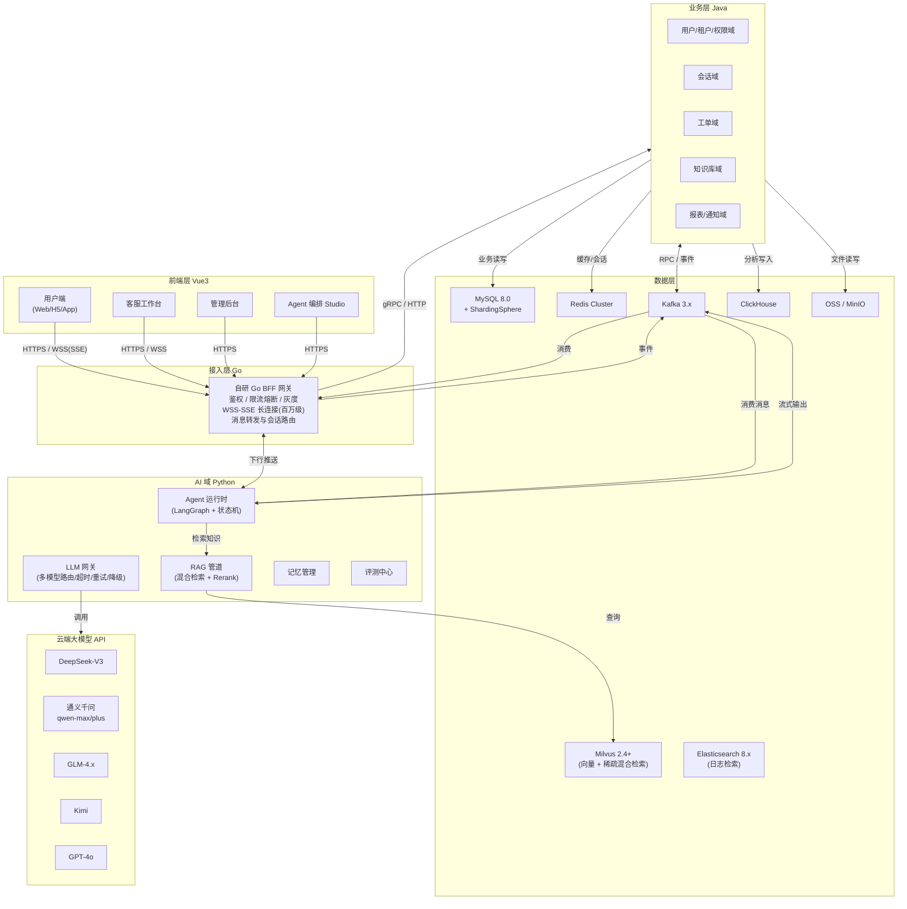
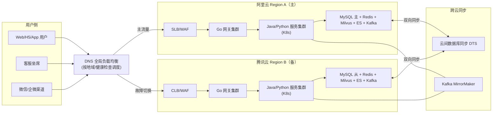
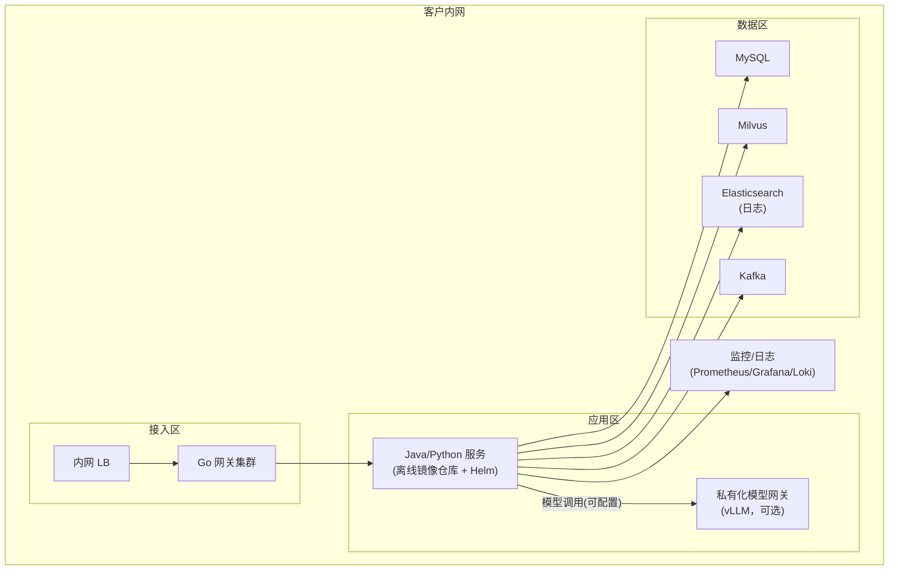
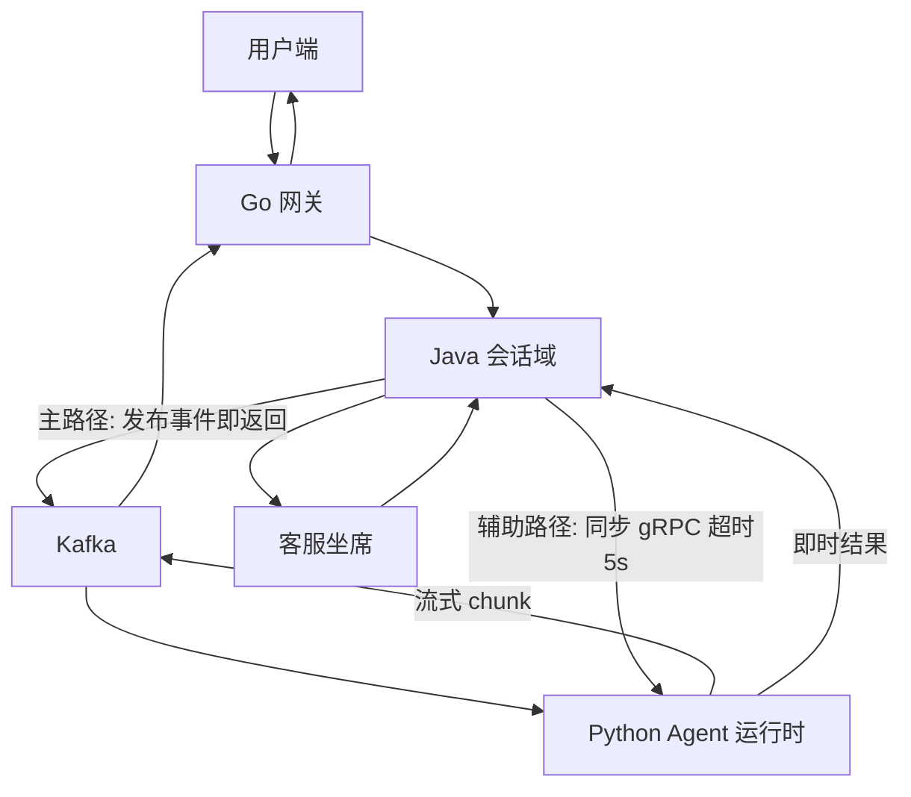
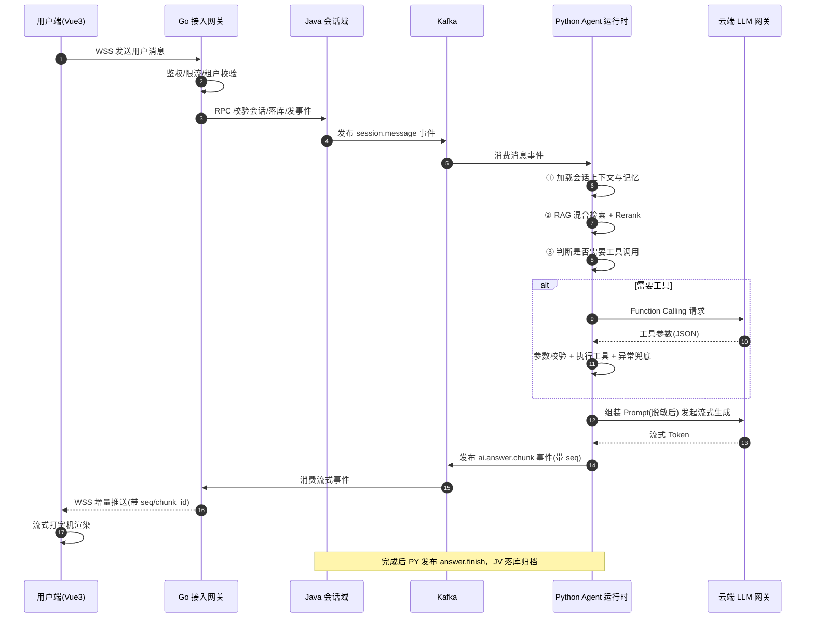
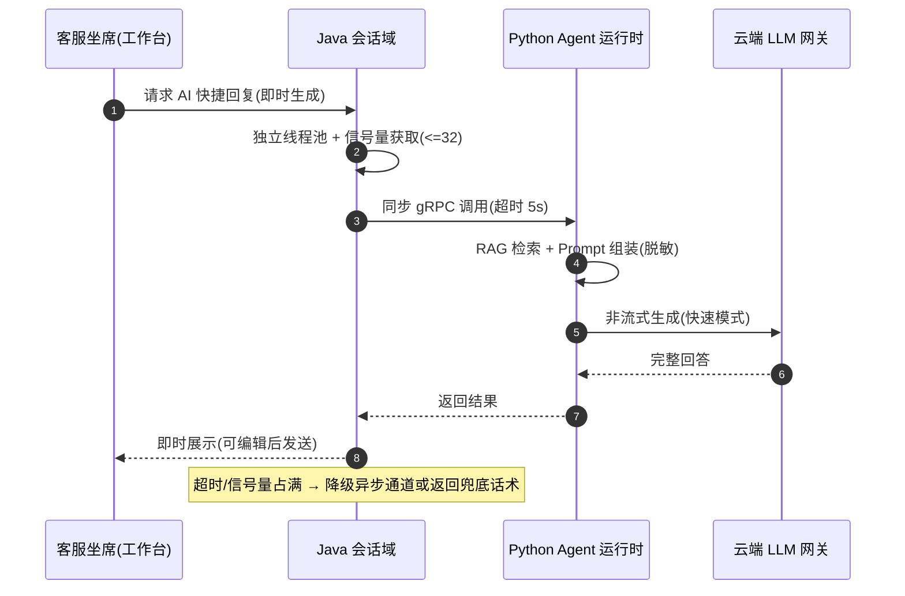
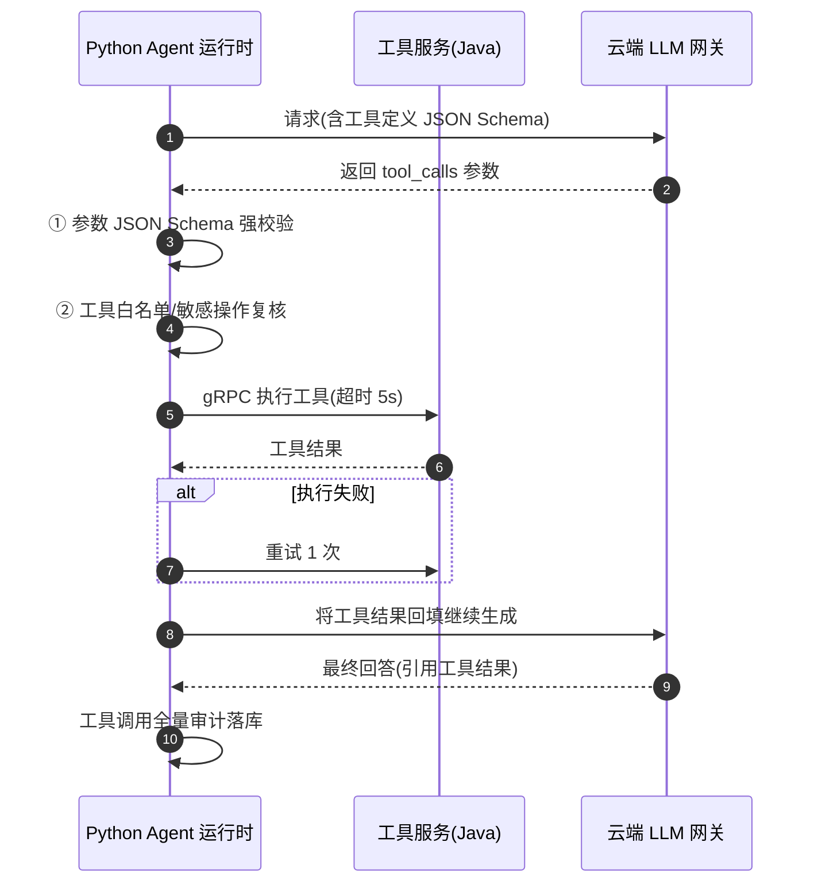
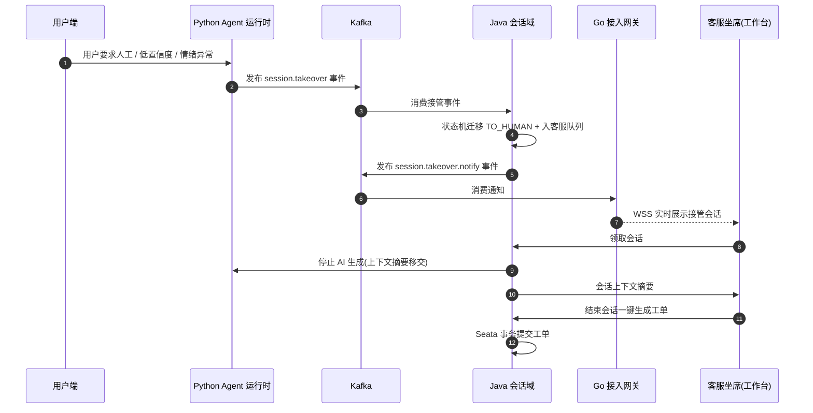
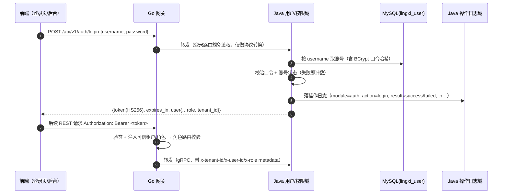

# 大型 AI Agent 智能客户应用 — 架构设计

> 文档版本：v1.0 ｜ 日期：2026-10-11 ｜ 状态：待评审
>
> 配套文档：[技术选型与架构设计方案](./技术选型与架构设计方案.md)
>
> 技术栈：Java + Go + Python + Vue3 ｜ 业务形态：混合形态（智能客服 + Agent 编排）
> 规模目标：百万级用户 / QPS 5000+ / 多云容灾 + 私有化交付并存

> 说明：本文档中的架构图、时序图、拓扑图均采用 Mermaid 语法绘制，可在支持 Mermaid 的编辑器（VS Code + Markdown Preview Mermaid、Typora、语雀、GitHub）中直接渲染查看。

---

## 目录

1. [设计目标与约束](#一设计目标与约束)
2. [总体技术架构](#二总体技术架构)
3. [分层架构详解](#三分层架构详解)
4. [网络拓扑架构](#四网络拓扑架构)
5. [核心链路时序](#五核心链路时序)
   - [调用模式选型决策（异步为主 + 同步兜底）](#51-调用模式选型决策异步为主--同步兜底)
   - [一次完整对话链路（异步主路径）](#52-一次完整对话链路异步主路径)
   - [同步调用链路（低延迟场景）](#53-同步调用链路低延迟场景)
   - [工具调用链路](#54-工具调用链路)
   - [人工接管链路](#55-人工接管链路)
6. [技术栈详解](#六技术栈详解)
7. [数据架构与存储设计](#七数据架构与存储设计)
8. [部署与运维架构](#八部署与运维架构)
9. [性能与可用性设计](#九性能与可用性设计)
10. [附录：关键术语](#十附录关键术语)

---

## 一、设计目标与约束

### 1.1 业务目标

- **智能客服核心**：多渠道接入（Web/H5/App/微信/企微）、多轮对话、RAG 知识问答、情绪识别、人工接管、工单闭环
- **Agent 编排能力**：运营侧低代码编排 Agent 工作流（工具调用、条件分支、定时触发）

### 1.2 非功能目标

| 指标 | 目标 |
|---|---|
| 规模 | 百万级注册用户，日对话峰值 QPS 5000+ |
| 长连接 | 50 万+ 并发会话（WSS/SSE） |
| 首字延迟 | < 800ms |
| 工具调用超时 | < 5s |
| 可用性 | 99.99%（多云双活容灾 + 私有化交付并存） |
| 数据合规 | PII 脱敏进模型、租户隔离、全链路审计 |

### 1.3 架构设计原则

| 原则 | 说明 |
|---|---|
| 单向依赖 | 前端 → Go 网关 → Java 业务域 / Python AI 域，事件经 Kafka 异步解耦，避免循环调用 |
| 事件驱动 | 会话/消息/工单/审计全部事件化，异步削峰、故障隔离 |
| AI 域隔离 | Python AI 域不直连业务库，仅通过 RPC/事件交互，保障业务数据安全边界 |
| 无状态化 | 连接无状态，会话状态收敛至 Redis + Java 域落库，支持水平扩展与秒级滚动发布 |
| 多云可移植 | 全容器化 + Helm 统一交付，公有云与私有化部署同构 |

---

## 二、总体技术架构



### 核心设计说明

1. **单一网关入口**：所有南北流量统一经 Go 网关，负责鉴权、限流、长连接与消息转发，业务域不直接暴露。
2. **异步消息总线**：跨域协作（Java ↔ Python、Python → Go 下行推送）全部走 Kafka，实现削峰、解耦与故障隔离。
3. **模型接入统一**：Python 域通过 LLM 网关统一接入多家云端模型，按路由策略分级调度，故障自动降级。

---

## 三、分层架构详解

### 3.1 接入层（Go）

| 职责 | 说明 |
|---|---|
| 协议接入 | HTTPS 短连接 + WSS/SSE 长连接，单实例支撑 10 万+ 连接 |
| 鉴权与租户 | JWT 校验、租户上下文注入、接口级 RBAC 鉴权 |
| 流量治理 | 令牌桶限流、滑动窗口熔断、灰度发布（按租户/用户 hash） |
| 会话路由 | 按租户 hash 路由至 Java 会话域实例，保证会话粘性 |
| 消息完整性 | 增量消息携带 `seq` + `chunk_id`，断连重连断点续拉（本地缓冲 30s） |

### 3.2 业务层（Java）

| 领域模块 | 核心能力 |
|---|---|
| 用户/租户/权限域 | 账号体系、租户隔离、RBAC 权限、操作审计 |
| 会话域 | 会话状态机、会话上下文持久化、接管队列、排队调度 |
| 工单域 | 工单创建/流转/关闭，Seata 分布式事务保障一致性 |
| 知识库域 | 知识分类/标签、文档上传与版本、租户与权限隔离、切片任务调度、索引状态回写 |
| 报表/通知域 | 会话漏斗、满意度、Token 消耗统计、消息通知 |

### 3.3 AI 域（Python）

| 模块 | 核心能力 |
|---|---|
| 调用入口（双通道） | 异步通道：Kafka 消费（会话消息、批量任务）；同步通道：gRPC 服务（低延迟场景），均统一进入 Agent 运行时 |
| LLM 网关 | 多模型路由、超时控制（首字 10s/总 120s）、指数退避重试（3 次）、降级切换、Token 审计 |
| Agent 运行时 | LangGraph 图式编排 + 自研会话状态机，控制工具调用、条件分支、人工接管 |
| RAG 检索管道 | Query 改写 → Milvus 混合检索（稠密 kNN + 稀疏匹配，RRF 融合）→ Rerank（bge-reranker-v2-m3，Top-K（默认 10）→Top5）→ 父块回填 → 拼装 Context |
| 知识入库管道 | 文档解析（按类型分流）→ 结构感知切分（父子块）→ bge-m3 批量向量化 → Milvus 集合写入（Kafka 异步触发） |
| 记忆管理 | 近期 N 轮 + 检索知识 + 长程记忆摘要（分层压缩），按会话隔离 |
| 评测中心 | Golden Set 回归、回答质量评分、幻觉检测、线上 Badcase 回流 |

### 3.4 数据层

| 组件 | 定位 |
|---|---|
| MySQL + ShardingSphere | 业务主库，会话/工单按租户+时间分片 |
| Redis Cluster | 会话状态缓存、限流计数、分布式锁、断连缓冲 |
| Milvus 2.4+ | 向量数据库：知识库子块稠密 + 稀疏混合检索、父块回填（Collection 别名 `lingxi_kb_chunk`） |
| Elasticsearch 8.x | 日志检索：应用/审计日志全文检索、对话消息索引（ILM 生命周期管理） |
| Kafka | 事件总线（会话/消息/工单/审计事件、AI 流式输出） |
| ClickHouse | 分析报表（漏斗、满意度、Token 审计） |
| OSS/MinIO | 文件与知识库附件存储 |

> 实施现状（M5-5.1）：**分析报表本期以 MySQL 落地**（明细表 + 三张聚合表，`event_id` 幂等去重），原因见《工程设计与开发规划》5.1 交付说明（本机环境无 ClickHouse）。分析存储经依赖倒置端口（`ReportRepository` / `AnalyticsEventRepository`）与 `lingxi.report.store` 配置项隔离，**设计意图不变，后续可平滑替换为 ClickHouse**（只需新增一套端口实现，应用层零改动）。

### 3.5 前端层（Vue3）

| 应用 | 说明 |
|---|---|
| 用户端（Web/H5/App WebView） | 会话界面、流式打字机渲染、消息重连恢复 |
| 客服工作台 | 实时会话列表、人工接管、快捷回复、工单一键生成 |
| 管理后台 | 租户/用户/知识库/权限管理、报表可视化（ECharts） |
| Agent 编排 Studio | 拖拽式工作流编排、工具配置、版本发布 |

---

## 四、网络拓扑架构

### 4.1 公有云多活拓扑（阿里云 + 腾讯云双活）



### 4.2 私有化交付拓扑



**说明**：私有化交付与公有云部署架构同构（同一套 Helm Charts），差异仅在于模型网关地址可指向私有化 vLLM，满足数据不出域要求。

---

## 五、核心链路时序

### 5.1 调用模式选型决策（异步为主 + 同步兜底）

**背景**：LLM 生成是「慢且贵」的依赖（秒级~分钟级、按 Token 计费）。若 Java 同步调用 Agent 层，AI 生成期间 Java 的线程/连接会被长期占用，毫秒级的业务接口（工单/报表/知识库 CRUD）会被慢依赖拖垮，故主路径选择 Kafka 异步事件驱动。

#### 两种模式对比

| 考量点 | 异步（Kafka，主路径） | 同步（gRPC，辅助） |
|---|---|---|
| 慢依赖隔离 | ✅ Java 发完事件即释放线程，AI 慢不影响业务快 | ❌ AI 生成期间 Java 线程被占用 |
| 削峰填谷 | ✅ LLM 高峰消息在 Kafka 排队，平滑消费 | ❌ 高峰只能排队/拒绝 |
| 容错重放 | ✅ 消费失败可重放、幂等消费 | ❌ 失败即返回，需调用方兜底 |
| 流式输出 | ✅ chunk 事件流天然匹配 | ⚠️ 需占用长连接原路回传 |
| 扩缩容 | ✅ 两侧独立扩缩容 | ⚠️ 强耦合，需同步调限流 |
| 实现复杂度 | 中（幂等、事件建模） | 低（调用栈直达） |

#### 混合共存的路由规则

| 场景 | 模式 | 说明 |
|---|---|---|
| 用户端对话（高并发、流式） | 异步（主） | 用户 → Go 网关 → Java 落库 → Kafka → Agent → 流式回传 |
| 坐席 AI 快捷回复（内部低频、需即时结果） | 同步（辅助） | Java 直连 Agent gRPC，超时 5s 快速失败 |
| 批量任务（知识向量化、离线评测） | 异步 | Kafka 队列削峰，失败重试 |
| 定时触发的 Agent 工作流 | 异步 | 事件触发，不阻塞主链路 |

#### 同步通道的隔离约束（强制）

- **线程池隔离**：Java 侧为 AI 同步调用单独分配线程池 + 信号量（如 32 并发），禁止占用公共业务线程池
- **超时快速失败**：同步调用超时 5s，超时即返回兜底话术，不无限等待
- **降级一致性**：同步通道超载（信号量占满）时自动降级为异步通道，保证请求不丢
- **双通道复用**：两条通道最终都进入同一 Agent 运行时与 LLM 网关，逻辑唯一、仅差异通道

#### 混合模式示意图



### 5.2 一次完整对话链路（异步主路径）



### 5.3 同步调用链路（低延迟场景）

适用于坐席 AI 快捷回复等内部低频、需即时结果的场景，走同步 gRPC 并强制隔离约束。



### 5.4 工具调用链路（Function Calling）



### 5.5 人工接管链路



---

### 5.6 认证、权限与操作日志链路（2026-10-15 新增需求）

#### 5.6.1 设计目标

- 运营后台与工作台统一走**账号密码登录**，登录后凭无状态 JWT 访问全部受保护资源（REST + WSS）。
- 网关只做**验签与租户注入**，签发与账号体系收敛在 Java 用户/权限域（单一权威），密钥经环境变量共享。
- 所有管理动作与登录事件**可审计**：谁、何时、在哪个租户、对什么资源、做了什么、结果如何。

#### 5.6.2 登录与鉴权链路



**WSS 令牌传递**：浏览器 WebSocket API 不支持自定义请求头，故网关鉴权中间件同时接受
`Authorization: Bearer`（REST）与 `?token=`（WSS 握手）；两者校验逻辑完全一致。
**令牌有效期**：默认 8 小时（`LINGXI_AUTH_TOKEN_TTL_SECONDS`），过期即 401 由前端跳登录页；
无状态令牌不做服务端会话表，登出由前端清除本地令牌 + 后端落审计。

#### 5.6.3 角色模型（RBAC）

| 角色 | 定位 | 可访问能力 |
|---|---|---|
| `admin` | 平台管理员 | 全部能力：用户管理、系统日志、知识库/工作流管理、报表、工作台、门户 |
| `agent` | 客服坐席 | 工作台（会话队列/接管/快捷回复/工单）、报表查看 |
| `user` | 终端用户 | 门户会话、满意度评价 |

- 校验分两层：**Go 网关按路由做粗粒度拦截**（进入业务域前拒绝，节省下游资源）；
  **Java 侧按方法做细粒度校验**（`@RequireRole`，防止绕过网关直连）。
- 缺省策略：网关 `GATEWAY_ENABLE_AUTH=false`（本地免登录联调）时跳过校验，
  但**生产必须开启**；`/api/v1/health` 与 `/api/v1/auth/login` 恒豁免。

#### 5.6.4 操作日志（审计）范围界定

| 日志类别 | 载体 | 归属 |
|---|---|---|
| 操作/审计日志（谁做了什么） | MySQL `lingxi_operation_log` + REST 查询 + 前端日志页 | **本次交付** |
| 租户隔离拒绝审计 | 同上（结构化落库，保留日志输出） | 本次交付（M5-5.5 审计端口换落库实现） |
| 系统运行日志（进程/GC/慢查询） | Loki/ES 采集与检索 | 归 M5 可观测性（5.2/ops），不在本轮 |

#### 5.6.5 前端信息架构

- **登录页**：暗色科技风（渐变网格 + 光效动效 + 内联 SVG 标识），文案「智能平台」，
  零外部图片依赖（私有化离线可用）；账号密码表单 + 错误提示 + 登录中状态。
- **主框架**：侧边菜单（由 `menu.ts` 统一配置，按角色过滤）+ 顶栏用户模块（用户名/角色/退出）。
- **菜单项**：门户会话、客服工作台、运营报表、编排 Studio、系统日志、用户管理。
- **路由守卫**：未登录 → 登录页（带 `redirect` 回跳）；角色不足 → 403 提示页。

---

## 六、技术栈详解

### 6.1 前端层

| 技术组件 | 版本（主要） | 用途 | 关键设计 |
|---|---|---|---|
| Vue 3 | 3.x | 前端框架 | 组合式 API，`<script setup>` |
| Vite | 5.x+ | 构建工具 | 开发热更新、生产分包 |
| TypeScript | 5.x | 类型安全 | 严格模式，接口类型由 OpenAPI 生成 |
| Pinia | 2.x/3.x | 状态管理 | 会话状态、用户态、路由守卫 |
| Vue Router | 4.x | 路由 | 权限路由、动态菜单 |
| Naive UI | 2.x | UI 组件库 | 工作台/Studio 重交互场景 |
| ECharts | 5.x | 可视化 | 报表图表 |
| XState（可选） | 5.x | 前端状态机 | 复杂交互状态建模 |

**流式渲染**：`fetch + ReadableStream` 逐 chunk 解析 SSE 增量，实现打字机效果；WSS 通道负责实时会话消息与坐席事件推送。

### 6.2 接入层（Go）

| 技术组件 | 版本（主要） | 用途 | 关键设计 |
|---|---|---|---|
| Go | 1.22+ | 开发语言 | 协程模型支撑百万级长连接 |
| Gin | 1.10.x | HTTP 框架 | 路由中间件（鉴权/限流/审计） |
| gorilla/websocket | 1.5.x | WebSocket 长连接 | 或选 gnet 提升性能 |
| gRPC-Go | 1.6x.x | 与 Java 域 RPC | Proto 契约，双向流 |
| JWT | golang-jwt/jwt/v5 | 认证 | 无状态 Token + 租户声明 |
| Redis client | go-redis/v9 | 会话/限流 | 令牌桶计数、断连缓冲 |
| Prometheus client | 1.x | 指标暴露 | QPS/延迟/连接数/错误率 |

### 6.3 业务层（Java）

| 技术组件 | 版本（主要） | 用途 | 关键设计 |
|---|---|---|---|
| JDK | 21 (LTS) | 运行环境 | 虚拟线程提升 IO 并发 |
| Spring Boot | 3.3.x | 应用框架 | 模块化多域 |
| Spring Cloud Alibaba | 2023.x | 微服务套件 | Nacos 注册配置中心 |
| Nacos | 2.x | 注册/配置 | 服务发现、动态配置、灰度 |
| Sentinel | 1.8.x | 流量治理 | 熔断/限流/热点防护兜底 |
| Seata | 1.8.x | 分布式事务 | 工单跨域事务 AT 模式 |
| ShardingSphere | 5.x | 分库分表 | 会话/工单按租户+时间分片 |
| MyBatis-Plus | 3.5.x | ORM | 单表 CRUD 简化 |
| OpenFeign | 4.x | 服务调用 | Java 域内 RPC |
| WebClient | 6.x | 出站 HTTP 集成 | 非阻塞/超时重试/SSE，调 Python AI 与第三方系统 |
| gRPC | 1.6x.x | 跨语言 RPC | 与 Go/Python 契约通信 |

### 6.4 AI 域（Python）

| 技术组件 | 版本（主要） | 用途 | 关键设计 |
|---|---|---|---|
| Python | 3.12 | 开发语言 | asyncio 全异步 |
| FastAPI | 0.115+ | API 框架 | 异步高性能、Pydantic 校验 |
| LangGraph | 0.2+ | Agent 编排 | 图式工作流、可观测、断点恢复 |
| langchain-core | 0.3+ | LLM 抽象 | 统一调用接口 |
| openai SDK | 1.x | 模型接入 | 兼容 OpenAI 协议的网关直连 |
| pymilvus | 2.4+ | 向量检索 | 稠密 + 稀疏混合检索（Hybrid Search + RRF） |
| 云端稠密嵌入（默认国内低延迟服务，如硅基流动 bge-m3）+ jieba/BM25（本地稀疏） | 3.x | Embedding | 方案 C：稠密走云端免部署、稀疏走本地毫秒级；云端 API **不返回** bge-m3 稀疏词权重，由本地词频权重补齐，保留双字段混合检索；Provider 无关（OpenAI 兼容，可仅改 base_url 切换境内/境外服务）；查询向量走 LRU+TTL 缓存，命中即跳过云端往返（首字延迟优化） |
| bge-reranker-v2-m3 | - | 精排 | 召回 Top-K（默认 10）→ 精排 Top5（云端托管 REST 调用） |
| Pydantic | 2.x | 数据校验 | 工具参数/配置强类型 |
| Prometheus client | - | 指标暴露 | 调用成功率/延迟/Token 消耗 |

**Agent 约束**（强制）：

- 所有 LLM 调用含超时（首字 10s/总 120s）、指数退避重试（3 次）、降级（主模型失败切换备用）
- RAG 检索结果必须经 Rerank 再入生成环节
- 同步阻塞操作（向量检索、云端嵌入、工具调用）**不得直接占用事件循环**，须放入工作线程执行，保证多会话并发不被单个慢请求串行化
- PII 数据进入模型前必须脱敏（手机/证件/地址正则 + 自定义实体识别）
- 工具调用必须做参数校验与异常兜底
- 流式响应必须处理断连重连与消息完整性（seq 续传）

### 6.5 数据与中间件

| 组件 | 版本（主要） | 用途 | 关键设计 |
|---|---|---|---|
| MySQL | 8.0 | 业务主库 | 分库分表，Binlog 同步 |
| Redis | 7.x | 缓存/状态 | Cluster 模式，AOF 持久化 |
| Milvus | 2.4+ | 向量检索 | 稠密 + 稀疏混合检索，Collection 别名零停机切换 |
| Elasticsearch | 8.x | 日志检索 | 应用/审计日志与对话消息全文检索，ILM 生命周期管理 |
| Kafka | 3.6+ | 事件总线 | 分区按租户/会话 hash，至少一次语义 |
| ClickHouse | 24.x | 分析 | 列式存储，漏斗/满意度报表 |
| OSS / MinIO | - | 对象存储 | 附件、知识库文件、日志归档 |

### 6.6 部署与可观测

| 组件 | 版本（主要） | 用途 |
|---|---|---|
| Kubernetes | 1.28+ | 容器编排，多云/私有化同构 |
| Helm | 3.x | 应用打包与版本管理 |
| ArgoCD | 2.x | GitOps 持续交付 |
| Docker | 24+ | 镜像构建（多阶段构建） |
| Prometheus + Grafana | 2.x / 10.x | 指标采集与大盘 |
| Loki | 3.x | 日志聚合检索 |
| OpenTelemetry | 1.x | 全链路 Trace（Go/Java/Python 串联） |

---

## 七、数据架构与存储设计

### 7.1 数据分类与存储策略

| 数据类型 | 存储 | 分片/保留策略 |
|---|---|---|
| 用户/租户/权限 | MySQL | 按租户分片 |
| 会话状态 | Redis + MySQL | 热数据 Redis，冷数据 MySQL 归档 |
| 对话消息 | MySQL（近 N 天）+ ES（索引） | 按月分表，ES 支撑检索 |
| 工单 | MySQL（Seata 事务） | 按租户+时间分片 |
| 知识库文档 | MySQL（元数据）+ OSS（文件）+ Milvus（向量 + 稀疏） | 版本化管理 |
| 向量数据 | Milvus（Collection + 别名） | HNSW/SPARSE 索引，按租户分区隔离 |
| 分析数据 | ClickHouse | TTL 按策略过期 |
| 审计日志 | ES / ClickHouse | 永久保留，合规审计 |

### 7.2 会话上下文管理

```
最近 N 轮对话(Redis, TTL)
        │ 超出窗口
        ▼
摘要压缩(LLM 生成) ──▶ 长程记忆(MySQL/ES)
        ▲
        │ 新会话载入
会话上下文 = 长程记忆摘要 + 最近 N 轮 + 本次检索知识
```

### 7.3 PII 脱敏管道

```
用户消息 ──▶ 实体识别(正则 + 模型) ──▶ 替换为占位符 ──▶ 进入 LLM
                                              │
                                       原值映射表(Redis/MySQL, 会话内)
                                              │
LLM 回答 ──▶ 占位符还原 ──▶ 返回用户
```

### 7.4 知识库存储与索引设计

#### 7.4.1 存储分层

| 层 | 载体 | 内容 |
|---|---|---|
| 原始文件 | OSS / MinIO | 上传的 PDF/Word/PPT/Excel/HTML 等原件，按 `tenant/kb/doc/version` 路径组织 |
| 文档元数据 | MySQL | 知识库、分类/标签、文档、版本、切片任务状态（Java 知识库域） |
| 子块 | Milvus | 切分产物：含稠密/稀疏向量与 `parent_id`（Collection 别名 `lingxi_kb_chunk`） |
| 父块 | 不单独存储 | 由同 `parent_id` 的子块按 `seq` **聚合回填**（Milvus 2.6 不支持无向量字段的集合，且单集合方案无冗余） |
| 向量 | Milvus `FLOAT_VECTOR`（bge-m3，1024 维，cosine）+ `SPARSE_FLOAT_VECTOR` | 与子块同 Collection 存储，混合检索 |
| 任务事件 | Kafka | `kb.doc.ingest`（入库）/ `kb.doc.indexed`（完成） |
| 日志检索 | Elasticsearch | 应用/审计日志与对话消息全文检索（与知识库链路解耦） |

#### 7.4.2 入库管道（异步批处理）

```
Java 知识库域: 上传校验 + 落元数据 → OSS/MinIO
        │ Kafka: kb.doc.ingest（削峰、可重试、失败隔离）
        ▼
Python 入库管道: 解析(按类型分流) → 结构感知切分(父子块) → bge-m3 批量向量化
        │ Milvus upsert（按 doc_id 先删后插）
        ▼
Milvus: lingxi_kb_chunk_v{n} ── 回写 Kafka: kb.doc.indexed ──▶ Java 更新文档版本状态
```

#### 7.4.3 检索管道（同步在线）

```
Query → 改写/扩展 → Milvus Hybrid Search(稠密 kNN + 稀疏匹配, RRFRanker 融合) → Top-K（默认 10）
      → bge-reranker-v2-m3 精排 Top5 → 按 parent_id 回填父块 → Context 拼装 → LLM
```

检索**强制携带 `tenant_id` 过滤**，隔离多租户知识；入库与检索共用同一 Collection，避免双写不一致。

#### 7.4.4 分层切分模型（结构感知 + 父子块）

核心思想：以「子块检索、父块生成」化解「召回精度」与「上下文完整性」的矛盾。

| 层级 | 粒度 | 用途 |
|---|---|---|
| 文档（doc） | 原始文件 | 版本、权限、溯源 |
| 父块（parent chunk） | 章节级 1k~2k token | 回填给 LLM 生成 |
| 子块（child chunk） | 256~512 token | 向量化与召回（精度优先） |

**切分算法（五步）**

1. **解析成结构树**：按文档类型解析出标题层级 / 工作表 / 幻灯片页等结构节点。
2. **递归切分**：优先按结构边界（H1→H6、页、表）切；节点超长时再按中文句界（。！？；\n）二次切分，避免截断语义。
3. **子块生成**：目标 256~512 token，句界对齐，相邻子块保留 10%~15% 重叠，防跨块语义断裂。
4. **父块归并**：同一结构节点下的连续子块归并为父块（1k~2k token），子块写入 `parent_id`。
5. **元数据注入**：子块携带 `heading_path`（如 `售后政策 > 退换货 > 时效`）、`doc_type`、`page`、`seq`，供过滤与引用标注。

#### 7.4.5 各类型文档切分策略矩阵

| 文档类型 | 解析库 | 切分单元 | 子块策略 | 父块策略 | 关键元数据 |
|---|---|---|---|---|---|
| **PDF**（文本型） | PyMuPDF / pdfplumber | 章节 → 段落 | 段落按 256~512 token 句界切 | 章节 | page、bbox、heading_path |
| **PDF（扫描件）** | PaddleOCR / RapidOCR | 版面块 → 段落 | OCR 后同文本型 | 页/章节 | page、ocr_confidence |
| **Word (.docx)** | python-docx / unstructured | Heading 1–6 树 | 段落切分 | 章节 | heading_path、style |
| **PPT (.pptx)** | python-pptx | 页 → 要点 | 每页要点合并为 1~2 子块 | 单页或连续同标题页 | slide_no、title |
| **Excel / CSV** | openpyxl / pandas | 表 → 行组 | **表头语义化转写**后按行组切 | 单表 / 分片（行数阈值） | sheet、table_id、header、row_range |
| **HTML** | trafilatura / readability | 标题树 | 去噪转 Markdown 后按段落切 | 章节 | url、title、publish_time |
| **Markdown** | markdown-it / mistune | H1–H6 树 | 段落切分 | 章节 | heading_path |
| **纯文本** | 规则分节 | 空行/分节符 → 段落 | 段落切分 | 相邻段落聚合 | - |

> **表格专项说明**：Excel/CSV 禁止按单元格切分（会彻底丢失语义）。采用「表头 → 行」语义化转写，例如把
> `型号=X1, 价格=399, 库存=20` 转写为「型号 X1 的价格为 399 元，当前库存 20 件」，再作为子块向量化。

#### 7.4.6 Milvus Collection 结构

Collection 别名 `lingxi_kb_chunk` → 实际 Collection `lingxi_kb_chunk_v{n}`（支持零停机重建与版本切换）。

**子块 Collection `lingxi_kb_chunk`**

| 字段 | 类型 | 说明 |
|---|---|---|
| `chunk_id` | VarChar（主键） | 子块唯一 ID |
| `doc_id` / `kb_id` / `tenant_id` | VarChar | 文档/知识库/租户，检索必带租户过滤 |
| `parent_id` | VarChar | 父块分组标识，用于聚合回填（建倒排索引加速） |
| `content` | VarChar | 子块原文（供引用与展示） |
| `dense_vector` | FLOAT_VECTOR(dim=1024, cosine) | bge-m3 稠密向量，kNN 召回 |
| `sparse_vector` | SPARSE_FLOAT_VECTOR | bge-m3 稀疏词权重，关键词召回 |
| `heading_path` / `doc_type` / `page` / `seq` / `meta` | VarChar / Int64 / JSON | 过滤与引用溯源 |

- 索引：稠密 `HNSW`（或 `IVF_FLAT`）；稀疏 `SPARSE_INVERTED_INDEX`（度量 `IP`）；`doc_id`、`parent_id` 建 `INVERTED`。
- 分区：以 `tenant_id` 作 Partition Key（16 分区），天然多租户隔离。
- 混合检索：多路 `AnnSearchRequest`（稠密 + 稀疏）+ `RRFRanker` 融合。

**父块：聚合回填，不单独存储**

Milvus 2.6 **不允许创建无向量字段的集合**（纯标量集合被拒），故父块不需要独立 Collection：
检索命中若干子块后，取命中子块的 `parent_id`，按 `tenant_id + parent_id` 过滤回查同组子块，
按 `seq` 升序拼接即得章节级父块内容。该方案单一存储、无冗余、无跨库，父块边界由切分器的
`parent_id` 分组天然保证。

> 说明：Milvus 专注向量检索，不承担全文与日志场景；全文/日志检索统一由 Elasticsearch 承担，二者职责解耦。

#### 7.4.7 更新、删除与版本一致性

- 文档版本变更 → **按 `doc_id` 全量替换**（先删旧 chunk 再写新 chunk），避免新旧切片混杂。
- 下线/删除 → 按 `doc_id` 逻辑删除 + 异步物理清理。
- Collection 结构升级 → 新建 `lingxi_kb_chunk_v{n+1}`，重建后切换别名，在线检索零停机。

---

### 7.5 用户、权限与操作日志数据模型（2026-10-15 新增需求）

**账号表 `lingxi_user`**（租户内账号，用户名租户内唯一）

| 字段 | 说明 |
|---|---|
| `user_id` | 主键（UUID） |
| `tenant_id` | 租户 ID（隔离主键，与全站一致） |
| `username` | 登录名（`(tenant_id, username)` 唯一） |
| `password_hash` | BCrypt 口令哈希（**明文口令不落库、不入日志**） |
| `display_name` | 展示名 |
| `role` | `admin` / `agent` / `user` |
| `status` | `ENABLED` / `DISABLED`（禁用后拒绝登录与鉴权） |
| `created_at` / `updated_at` / `last_login_at` | 时间戳（epoch ms） |

**操作日志表 `lingxi_operation_log`**（只追加，不更新）

| 字段 | 说明 |
|---|---|
| `log_id` | 主键（UUID） |
| `tenant_id` / `user_id` / `username` / `role` | 操作主体（登录失败时 `user_id` 可空） |
| `module` | 模块：`auth` / `user` / `knowledge` / `workflow` / `session` / `ticket` / `report` |
| `action` | 动作：`login` / `logout` / `create` / `update` / `delete` / `publish` / `take_over` / `isolation_denied` … |
| `resource_type` / `resource_id` | 目标资源（可为空） |
| `result` | `SUCCESS` / `FAILED` / `DENIED` |
| `detail` | 结果说明（失败原因；PII 不入库） |
| `client_ip` / `user_agent` | 来源信息（网关透传） |
| `elapsed_ms` / `created_at` | 耗时与时间戳 |

- **幂等与容量**：`log_id` 为主键保证重放不重复；索引 `(tenant_id, created_at)`、`(module, action, created_at)`；
  按月归档策略由运维侧承接（表结构预留时间索引）。
- **写入约束**：审计写入**不得阻断主链路**（失败仅告警），沿用 M5-5.5 的旁路原则。

---

## 八、部署与运维架构

### 8.1 CI/CD 流水线

```
代码提交 → 静态检查(ESLint/Pylint/Checkstyle) → 单元测试 → 契约测试(Pact)
    → 镜像构建(多阶段) → 安全扫描(Trivy) → Helm 打包
    → ArgoCD 灰度发布(金丝雀) → 指标回归 → 全量
```

### 8.2 环境划分

| 环境 | 用途 |
|---|---|
| dev | 本地开发，K8s 单节点 |
| test | 集成测试，契约测试网关 |
| staging | 预发，Golden Set 评测回归 |
| prod | 生产，多云双活 |

### 8.3 容量规划（起步参考）

| 资源 | 规模 |
|---|---|
| Go 网关实例 | 3 节点（10 万连接/节点） |
| Java 业务实例 | 6 节点（按域水平扩展） |
| Python AI 实例 | 4 节点（异步 IO，GPU 非必需） |
| Kafka | 3 Broker（3 副本） |
| MySQL | 主从 + 分片，云上 4C16G x 4 |
| Milvus | 3 节点（集群模式，稠密 + 稀疏索引） |
| Elasticsearch | 3 节点（日志检索，热温冷分层） |
| Redis | 3 主 3 从 Cluster |

---

## 九、性能与可用性设计

### 9.1 性能指标

| 指标 | 目标 | 保障手段 |
|---|---|---|
| 首字延迟 | < 800ms | Python 流式直推、Kafka 低延迟分区、热缓存 |
| 工具调用超时 | < 5s | gRPC 超时控制 + 快速失败 |
| 网关 P99 延迟 | < 50ms | Go 异步 IO、无状态连接 |
| 长连接容量 | 50 万+ | 连接无状态化 + 租户 hash 路由 |

### 9.2 可用性策略

- **多云双活**：DNS 全局负载 + 数据库 DTS 同步 + Kafka MirrorMaker，故障切换 RTO < 5min
- **降级链**：LLM 主模型失败 → 备用模型 → 兜底话术；RAG 检索失败 → 直接生成并提示
- **限流熔断**：网关层令牌桶限流 + Sentinel 业务层熔断，防止级联雪崩
- **消息可靠性**：Kafka 至少一次 + 幂等消费 + 死信队列告警
- **流式完整性**：seq 序号 + 断点续传，客户端重连不丢消息

---

## 十、附录：关键术语

| 术语 | 说明 |
|---|---|
| BFF | Backend For Frontend，面向前端聚合的后端网关 |
| RAG | Retrieval-Augmented Generation，检索增强生成 |
| Rerank | 对召回结果二次精排，提升送入模型的知识质量 |
| Function Calling | 模型输出结构化工具调用指令并执行 |
| PII | 个人敏感信息（手机号、证件号、地址等） |
| Golden Set | 评测黄金数据集，用于回答质量回归 |
| WSS/SSE | WebSocket Secure / Server-Sent Events 流式推送协议 |

---

> 本文档为架构设计评审版，将随里程碑（M1~M5）迭代更新。
